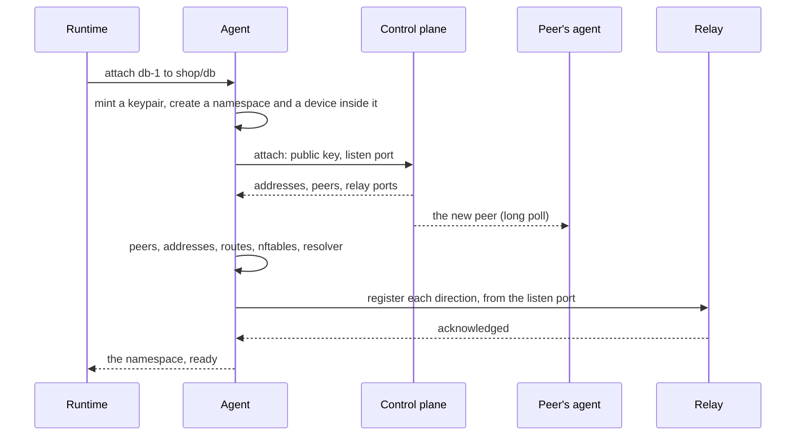
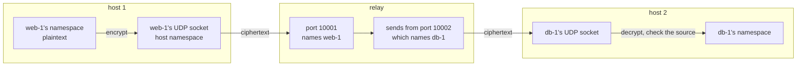
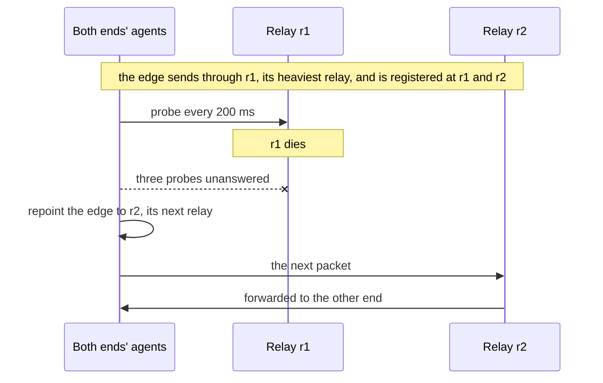
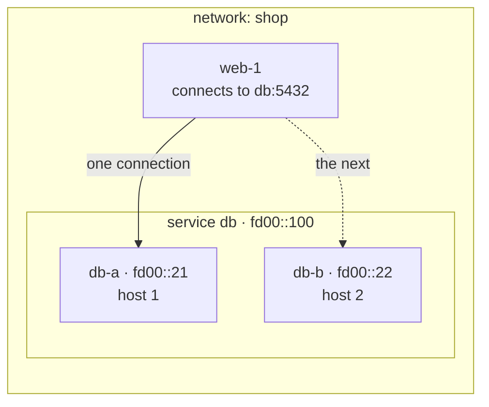

# wirenet

Ad-hoc VPCs with built-in service discovery, for high-churn workloads such as sandboxes and ephemeral compute. Each workload gets its own WireGuard key and address, finds services by name, and reaches a peer on another host 44 ms after it attaches.

Create a network per tenant, sandbox fleet or job. It costs nothing until a workload attaches, and its addresses may overlap any other network's. Workloads keep ordinary sockets, across hosts and behind NAT. Encryption happens at both ends in kernel WireGuard, and the relays between hosts carry ciphertext they cannot read.

## Contents

- [What sets it apart](#what-sets-it-apart)
- [Performance](#performance)
- [Quick start](#quick-start)
- [How it works](#how-it-works)
  - [The interface](#the-interface)
  - [The relay](#the-relay)
  - [Failover](#failover)
  - [Services and selection](#services-and-selection)
  - [Policy](#policy)
  - [Leases and keys](#leases-and-keys)
  - [Convergence](#convergence)
- [Operator guide](#operator-guide)
  - [Tuning](#tuning)
- [Alternatives](#alternatives)
- [Known limits](#known-limits)
- [Development](#development)

## What sets it apart

- **A key per workload, scoped to a lease.** The agent mints a keypair at attach and discards it at detach. Every peer checks a decrypted packet's source against the one address per family that key holds, so a host speaks only as the interfaces it holds now. See [Leases and keys](#leases-and-keys).
- **Revocation runs through peers.** Removing a key from its peers cuts an interface off whether or not its own host cooperates. See [Leases and keys](#leases-and-keys).
- **Relays that can't read traffic.** A relay forwards ciphertext and holds no key that decrypts or forges it. Each edge sends through one relay of its network's set, so more relays carry more traffic, and a dead relay's edges spread over the rest. See [The relay](#the-relay).
- **Load balancing with no balancer.** Each client picks a backend per connection in its own namespace. A change lands in one nftables transaction, so no client sees a partial set of backends, and established connections drain. See [Services and selection](#services-and-selection).
- **Service discovery with no discovery service.** Attaching a workload to a service registers it, and each workload resolves names through its own agent. There is no Consul, sidecar or client library.
- **Overlapping address spaces.** Two networks can use the same addresses, because no two networks share a kernel object.
- **Nothing needs inbound reachability.** Workloads behind NAT work, including NAT that gives them a new address on restart. See [The relay](#the-relay).

## Performance

Nine c6i.xlarge instances (4 vCPU, up to 12.5 Gb/s) in one placement group in us-east-1: four hosts, three relays, a control plane on Postgres, and a middle box for the gateway comparison. Plain TCP between two hosts carries 12.4 Gb/s.

| Event | Result |
|---|---|
| A new workload's first connection to a peer on another host, 20 peers | 50 ms p50, 60 ms max |
| A backend replaced, until every client reaches the new one | 25–45 ms p50, 36–55 ms p99 |
| One of two backends removed, rewriting half of each client's slots | 99–123 ms p50, 137–161 ms p99 |
| An etcd member moved to another host: its first connection to a peer, from the attach | 29 ms p50, 39 ms max |
| Its peers' lookups of its name answering the new address, from the commit | 10–11 ms p50, 17 ms max |
| A deny closing a wildcard to 30 sandboxes, from its commit | 9–11 ms p50, 16 ms max |
| The deny lifted, until every sandbox reaches db again | 20–25 ms p50, 64 ms max |
| A relay killed: an open TCP connection stalls | 0.82 s, then carries on |
| A relay killed: the next new connection | 0.22–0.26 s |
| Attaches and detaches across four hosts, 4 workers each | 46 pairs a second, no failures |
| Interfaces on one host | 1,000, at 841 KiB each |

Service changes ran under attach churn, with 30 clients over the four hosts. Ranges span two runs, six for the rule changes, and two of ten moves for the member.

Throughput runs at an 8,941-byte overlay MTU, the most a VPC's 9,001-byte path carries under WireGuard. WireGuard's cost is per packet, so at the 1,380-byte default, which a path across the internet needs, throughput drops substantially: to a third on one edge, and to half across relays.

| One edge, 8 streams | Throughput | Middle box busy | Traffic per CPU-second | Round trip p50, idle / loaded |
|---|--:|--:|--:|--:|
| Plain TCP | 12,410 Mb/s | | | 0.07 / 0.15–0.21 ms |
| Through a relay | 7,858–7,861 Mb/s | 1.6 cores | 5.00 Gb | 0.22 / 2.5–3.5 ms |
| Through a WireGuard gateway | 6,678–7,308 Mb/s | 3.5–3.7 cores | 1.90–1.96 Gb | 0.25 / 11.3 ms |
| Through a relay, 1,380-byte MTU | 2,535 Mb/s | 1.4 cores | 1.88 Gb | 0.22 / 4.1 ms |

| Relays | 24 edges at once | Relay CPU busy, of 4 vCPUs | Receiving hosts' CPU busy, of 4 vCPUs |
|--:|--:|--:|--:|
| none, plain TCP | 24.8 Gb/s | | 46–56% |
| 1 | 12.2 Gb/s | 85% | 84–91% |
| 2 | 23.9–24.3 Gb/s | 67–83% | 99–100% |
| 3 | 23.9–24.2 Gb/s | 33–71% | 100% |
| 3, 1,380-byte MTU | 13.0 Gb/s | 54–91% | 96–100% |

Each edge streams one TCP connection, from two sending hosts to two receiving hosts; plain TCP runs the same pairs without the overlay. Ranges span three runs at 8,941 bytes, and one at 1,380.

- **A dead relay costs an open connection 0.82 s.** Keys, sessions and conntrack live at the ends, so TCP retransmits across the switch and the connection carries on. Each edge the relay carried moves to its own next relay, so the survivors share its load.
- **Two relays carry what plain TCP does.** One relay fills its CPU at 12.2 Gb/s. Two carry 23.9–24.3 Gb/s, plain TCP's figure between the same hosts, and the receiving hosts spend every core on it, where plain TCP needs about half.
- **A relay costs less than half a gateway's CPU.** It forwards ciphertext, where a gateway decrypts and re-encrypts every byte: 5.0 Gb per CPU-second against 2.0.
- **A detach tells the control plane first.** Deleting a WireGuard device waits a grace period for each peer it holds: about a second under churn for a backend with 30 peers. Clients leave a departing backend while its device is deleted, which took a replacement from 1,037 ms to 27–48 ms.
- **Short windows.** A c6i.xlarge's network bursts to 12.5 Gb/s above a lower baseline, so each throughput test runs 10 seconds.

`bin/wirenet-lab run --env aws --plan all` reruns the test on a fleet from [deploy/README.md](deploy/README.md). [SPEC.md](SPEC.md#the-fleet-on-ec2) records every figure with its method.

## Quick start

One Linux machine with kernel WireGuard, nftables, `sudo` and `jq`. Start a control plane with an in-memory store, and an agent:

```console
go build -o bin/ ./cmd/wirenet-cp ./cmd/wirenet-agent ./cmd/wirenetctl
export WIRENET_ADMIN_TOKEN=$(openssl rand -hex 16)
bin/wirenet-cp --listen 127.0.0.1:8443 &
bin/wirenetctl host create h1 > host.json
sudo bin/wirenet-agent --cp http://127.0.0.1:8443 --credentials host.json --egress=false &
```

`--egress=false` leaves the host's IPv4 forwarding and egress filter alone. Drop it on a host that serves internet egress grants.

Create a network where `web` may reach `db` on port 8080, and attach a workload to each:

```console
bin/wirenetctl network create shop
bin/wirenetctl service create shop db
bin/wirenetctl service create shop web
bin/wirenetctl rule create shop web db --proto tcp --ports 8080
sudo bin/wirenetctl attach db-1 shop db > db.json
sudo bin/wirenetctl attach web-1 shop web > web.json
```

Each attach answers with the workload's namespace, address, interface and resolver. Serve from `db-1` and dial it by name from `web-1`:

```console
echo "hello from db-1" > index.html
sudo ip netns exec $(jq -r .namespace db.json) python3 -m http.server 8080 --bind :: &
sudo ip netns exec $(jq -r .namespace web.json) curl http://db.shop.internal:8080/              # hello from db-1
sudo ip netns exec $(jq -r .namespace web.json) curl --max-time 2 http://db.shop.internal:8081/   # refused by policy
sudo pkill -f "http.server 8080"
sudo bin/wirenetctl detach $(jq -r .interface web.json)
sudo bin/wirenetctl detach $(jq -r .interface db.json)
```

Inside the namespace, `127.0.0.53` is the agent's resolver, which Ubuntu's `/etc/resolv.conf` already names. A runtime writes the workload's `resolv.conf` from the attach answer, whose search domain lets `db` alone resolve.

`scripts/e2e` runs the same daemons with a relay and several hosts, each in a namespace of its own.

## How it works

An agent on each host builds a workload's whole network before the workload starts. The control plane holds networks, services, policy and leases, and pushes each host the changes it needs. Relays forward ciphertext between hosts.



### The interface

The agent creates the WireGuard device directly into the workload's namespace. A device keeps its encrypted socket in the namespace that created it, so plaintext lands in the workload and ciphertext leaves through the host, with no namespace move. A move waits on an RCU grace period under the RTNL lock and barely overlaps under concurrency: at 64 attaches at once, creating in place ran 8.5 times as many a second on a c6i.xlarge.

Each peer's `AllowedIPs` holds exactly that peer's address in each family. WireGuard checks every decrypted packet's source against it, so no peer can send as an address it was not granted.

The namespace is the unit of isolation, so a workload can be a container, a VM behind a TAP, or a process under `ip netns exec`.

### The relay

A relay has one port for each direction of each policy edge, so the port a packet arrives on names its sender. The agent registers each direction with an authenticated datagram sent from the interface's own listen port, which also holds the NAT mapping WireGuard uses. The relay forwards a packet from a direction's registered endpoint to the other direction's endpoint, from the other direction's port. That is where the receiver expects its peer, so WireGuard's roaming keeps both ends pointing at the relay. A data packet never moves an endpoint.



Every relay in a network's set carries traffic. Each edge sends through the relay with the highest rendezvous-hash weight for its two interfaces, among those its agent's probes find up. Both ends compute the same weights, so they choose the same relay, and a network's edges spread evenly over its relays.

The relay batches reads and writes with `recvmmsg` and `sendmmsg` and keeps no crypto, conntrack or per-flow state. Two interfaces on the same host skip it over loopback, still encrypted.

### Failover

Agents probe every relay of their networks every 200 ms. After three misses in a row, each edge the relay carried moves to its own next relay, where both ends have registered already. When the relay answers again, its edges move back.



A restarted relay reloads its ports and registrations from disk and forwards again within milliseconds.

### Services and selection



A service has a name and an address that last as long as it does. Relays carry ciphertext, so nothing in the middle can read a destination, and each client picks a backend in its own namespace:

```text
table inet wirenet {
  map db_slots { typeof numgen random mod 1024 : ip6 daddr; }
  chain services {
    type nat hook output priority dstnat;
    ip6 daddr fd00::100 tcp dport 5432 dnat to numgen random mod 1024 map @db_slots
  }
}
```

The slot count stays fixed, so a backend change rewrites only the slots whose backend moved. Conntrack pins each connection to its backend and translates the replies, so the application sees answers from the address it dialed. IPv6 is always on; IPv4 is opt-in per service.

A service's members can hold names, for software whose members address each other one by one, such as etcd. An attach with `--member etcd-1` makes `etcd-1.etcd.shop.internal` resolve to that workload's own address, while `etcd.shop.internal` still spreads connections over every member. One live workload holds a name. `--replace` revokes the holder and hands the name over in one transaction, so a member moves hosts while its peers keep their configuration, and the replaced process reaches none of them:

```console
wirenetctl rule create shop etcd etcd --proto tcp --ports 2379-2380   # members reach each other
sudo wirenetctl attach etcd-a shop etcd --member etcd-1
sudo wirenetctl attach etcd-d shop etcd --member etcd-2 --replace     # etcd-2's host is lost
```

### Policy

Policy names services, and denies every flow it does not name. A rule allows or denies, and either side may be `*`, every service but the one on the rule's other side:

```console
wirenetctl rule create shop web db --proto tcp --ports 5432        # web reaches db on one port
wirenetctl rule create shop '*' mirror --proto tcp --ports 443     # every other service reaches the mirror
wirenetctl rule create shop box mirror --deny --proto tcp --ports 443   # except the sandboxes
wirenetctl policy shop                                             # the flows the rules leave open
```

A deny takes its flows out of every allow, whatever the order, exactly down to the port. `*` never matches a service's own members: sandboxes in one service reach each other only through a rule naming the service on both sides, since a service connected to itself peers every two of its members.

An interface gets a peer only where policy permits a flow, so its peer count is its policy degree, whatever the network's size; `allow * -> mirror` makes the mirror's degree the network's. `AllowedIPs` decides whether a peer may speak as an address, and nftables decides whether a flow may happen. Both run in the receiver's kernel.

### Leases and keys

A lease binds an interface, its public key and its host, and the agent renews it. Private keys never leave the host; the control plane sees public keys only.

Revocation removes a key from its peers, so it needs nothing from the holder. That also lets an agent keep its configuration through a control-plane outage of any length: teardown follows the workload, and the fence holds.

### Convergence

A change sends one message to each host with a policy-connected interface. Each namespace applies it in one transaction, ordered so every intermediate state is safe:

| Change | Order |
|---|---|
| Add a backend | Install its peer, then add its slots |
| Remove a backend | Remove its slots; after a grace period, remove its peer, flush its conntrack entries and destroy the sockets addressed to it |
| Revoke an interface | Remove its slots, peer, conntrack entries and sockets at once |

Each client flips in one step. Across clients the change is eventually consistent, and each agent reports how long its namespaces took to settle (`wirenet_agent_convergence_seconds`).

## Operator guide

### Requirements

- **Hosts:** Linux with kernel WireGuard, nftables and `CONFIG_INET_DIAG_DESTROY`, which the agent checks at start. Run workloads without `CAP_NET_ADMIN` and `CAP_NET_RAW`.
- **Control plane:** Postgres, or `--store memory` for a test.
- **Relays:** raise `net.core.rmem_max` to at least `--socket-buffer` (8 MiB by default), or the kernel caps each socket's buffer.

`deploy/hostprep.sh` installs the packages, sets the sysctls and checks the kernel. `deploy/systemd` has a unit for each daemon.

### Starting a fleet

```console
wirenet-cp --store postgres://wirenet@db/wirenet --admin-token-file /etc/wirenet/admin-token
export WIRENET_CP=http://10.0.1.10:8443 WIRENET_ADMIN_TOKEN=...

wirenetctl relay create r1 --address 10.0.1.20 --ports 10000-60000 --probe-port 7000 > relay.json
wirenet-relay --cp $WIRENET_CP --credentials relay.json --state /var/lib/wirenet/relay --probe 10.0.1.20:7000   # on r1

wirenetctl host create h1 > host.json
wirenet-agent --cp $WIRENET_CP --credentials host.json                                                     # on h1

wirenetctl network create shop --relays r1,r2,r3
```

`--tls-cert` and `--tls-key` serve the control plane over TLS, and `--ca-file` pins its CA on agents and relays.

A runtime attaches a workload through the agent's socket, `/run/wirenet/agent.sock` (`wirenetctl attach NAME NETWORK SERVICE`), and starts the workload in the namespace the answer names, with a `resolv.conf` naming the answer's resolver and search domain.

### Changing the fleet

- **Add a relay:** create and start it, then name it in a network's `--relays`. A network's relay set is fixed when the network is created.
- **Lose a relay:** its edges move to their next relays within a second, and back when it returns.
- **Remove a host:** `wirenetctl host delete h1` revokes its interfaces at once.
- **Revoke an interface:** `wirenetctl interface revoke IFACE` removes its key from every peer, with no grace period.
- **Restart an agent:** traffic continues, since the kernel holds the data plane, and DNS queries wait in the socket buffer under systemd. The agent adopts its interfaces from its journal and the kernel.

### Tenants

A token is global or scoped to a set of networks. The operator's token is the one global admin; it issues admin tokens for a tenant's networks, and a host can be scoped to the networks it may attach into:

```console
wirenetctl network create shop --relays r1,r2 --interfaces 200 --edges 2000
wirenetctl admin create shop-admin --network shop > shop-admin.json      # the tenant's token
WIRENET_ADMIN_TOKEN=$(jq -r .token shop-admin.json) wirenetctl host create shop-vm --network shop > host.json
```

| Arrangement | Admin token | Host tokens |
|---|---|---|
| The tenant manages its networks on the operator's shared hosts | scoped | global, on hosts the operator runs |
| The tenant runs its own hosts and workloads too | scoped | scoped, on the tenant's hosts |
| The operator runs everything | global | global |

An admin token manages its networks' services, rules, interfaces and development machines, and hosts scoped within them. A network, interface or host outside its scope answers `not_found`. Only the operator creates networks, sets quotas, registers global hosts, and widens internet egress; an admin token may only narrow it. `wirenetctl host scope HOST --network NET` rescopes a host: it revokes the host's interfaces in the networks it loses, and the host's poll drops those networks at once.

A quota bounds a network's live interfaces, services, rules and edges; each edge holds two ports on every relay of the network's set, which every network on that relay shares. `wirenetctl quota show NET` reads it against what the network holds, and `--quota-*` on `wirenet-cp` sets the default for each bound a network's creation leaves out. Each scoped host and admin token may make 10 writes a second, bursting to 50, with 16 calls in flight on each replica (`--scoped-rate`, `--scoped-burst`, `--scoped-in-flight`); a refused call answers 429, which `cpclient` and the agent retry.

### Monitoring

Each daemon serves `/metrics`, `/healthz` and `/readyz` on its `--telemetry` address: `:9090` for the control plane, `:9091` for an agent, `:9092` for a relay. `deploy/monitoring` has a Prometheus config and a Grafana dashboard.

| Metric | Shows |
|---|---|
| `wirenet_agent_convergence_seconds` | Time from a commit to each namespace settling on it |
| `wirenet_agent_relay_up{relay}`, `wirenet_agent_relay_peers{relay}` | Which relays the agent finds up, and how many edges each carries |
| `wirenet_agent_interfaces{phase}`, `wirenet_agent_peers` | Interfaces by phase, and the peers their devices hold |
| `wirenet_relay_forwarded_bytes_total`, `wirenet_relay_dropped_packets_total{reason}` | Traffic forwarded and dropped |
| `wirenet_relay_udp_rcvbuf_errors_total` | Datagrams the host dropped on full receive queues; a climbing count means the relay is falling behind |
| `wirenet_cp_requests_total`, `wirenet_cp_store_transactions_total` | API requests and store transactions by result |
| `wirenet_cp_relay_ports`, `wirenet_cp_ipv4_quarantined` | Relay ports in use and in quarantine, and IPv4 addresses waiting for reuse |

### Tuning

**Relays per network.** One edge uses one relay core, and a relay forwards about 4–5 Gb per busy core at an 8,941-byte MTU, and about 2 at 1,380. On 4-vCPU machines at 8,941 bytes, two relays carried what plain TCP does between the same hosts.

**Drain grace.** `--drain-grace` (30 s) is how long clients keep a departing backend's peer so established flows can finish. A `cutover` service skips it.

**IPv4.** A service opts in with `--ipv4`. A released IPv4 address waits `--quarantine4` (2 minutes) after its interface drains, and a released relay port waits `--port-quarantine` (5 minutes).

## Alternatives

Relaying ciphertext is common: Tailscale's DERP, Nebula's relays and NetBird all do it. The measured advantage is over designs that terminate WireGuard in the middle. The case for wirenet is the identity model: a key per workload, scoped to its lease.

| Option | Choose it when |
|---|---|
| **Tailscale** | You need one client on every OS, including laptops and Windows, with NAT traversal solved. Its userspace data plane costs a daemon per node. |
| **Nebula** | You want a mature, self-hosted mesh with host certificates and lighthouse discovery, and host-level identity is fine-grained enough. |
| **Netmaker / NetBird** | You want managed WireGuard between machines you administer, with a dashboard and gateways. |
| **Cilium cluster mesh** | Your workloads are Kubernetes pods and you want policy and identity inside that model. |
| **SPIFFE with a service mesh** | You want workload identity and mTLS at L7, can change how applications dial, and need no overlapping L3 address spaces. |
| **A cloud VPC** | Every workload runs in one provider's region and you want no agent. |
| **Plain WireGuard, hub and spoke** | One operator, one network, a few hosts, and a gateway's throughput is enough. |

## Known limits

- **Not a lock.** A service that needs a single writer fences in its storage layer.
- **Rules name one service or every service.** Selecting services by label is planned, and would follow the same rule for a service's own members.
- **Relays are trusted for availability.** A relay can drop or misdeliver packets, though it can never read or forge them.
- **A global host's token admits it to every network.** A compromised host speaks only as the interfaces it holds, but can attach new ones to any service its scope admits. Scope every host that someone other than the operator controls.
- **Names are unique fleet-wide.** A tenant that registers a host under a taken name learns the name exists.
- **One control plane orders every change.** Every write takes the next revision from one row, so attaches, releases and policy changes serialize across networks.
- **The relay's socket model caps its edges.** One socket per directed port; the next step is XDP or TC.
- **A partition keeps an island alive.** A revoked interface cut off together with some of its clients keeps serving them until the partition heals.
- **No connection migrates.** A workload that moves breaks its connections, and clients reconnect.
- **A member's address changes when it moves.** Its name follows within the resolver's 5-second TTL; software that caches a resolved address for longer must resolve again.
- **Linux hosts, L3 only.** A laptop joins through a gateway interface with a stock WireGuard client.
- **A `CAP_NET_ADMIN` workload loses sender-side policy.** It keeps its identity, since the receiver enforces it.
- **A flat network runs out of relay ports.** Ports scale with policy edges, so segment a fully connected network.

## Development

[SPEC.md](SPEC.md) is the design contract and records every measurement. [PLAN.md](PLAN.md) is the phased build plan, [AGENTS.md](AGENTS.md) the working rules.

| Program | What it is |
|---|---|
| `cmd/wirenet-cp` | The control plane: networks, services, policy, leases, relays and edge ports over a transactional store, with long polls for agents and relays. |
| `cmd/wirenet-agent` | The host agent: each workload's namespace, device, peers, nftables table, resolver and egress link. |
| `cmd/wirenet-relay` | The ciphertext relay. |
| `cmd/wirenetctl` | The CLI: operator commands, attach and detach through the local agent, and development machines' configs. |
| `cmd/wirenet-sim` | The deterministic simulator. |
| `cmd/wirenet-lab`, `cmd/wirenet-bench` | The benchmark driver and its load tool, on this machine or a fleet on EC2. |
| `cmd/hostbench` | Kernel costs: device placement, netdev and peer concurrency. Runs as root and names everything `hb-*`. |
| `cmd/relay` | The prototype relay, kept for the relay-against-gateway comparison. |

### Testing

```console
go build ./... && go vet ./... && go test ./...   # unit tests, the determinism check, a simulator seed range
scripts/ci all                                   # every CI step; kernel and e2e tests run as root
scripts/e2e -test.run TestTwoHosts               # the daemons in namespaces, as root
WIRENET_TEST_POSTGRES=postgres://... go test ./internal/store/... ./internal/cp/...
```

### Simulator

A seed fixes the whole run: the deployment, its faults and its workload. The control plane, relays and agents run their real cores against models of the kernel and the network, and an attacker replays what it captures. At every instant each settled namespace must hold exactly what policy says it should; at the end, permitted flows must connect and forbidden ones must fail. Pass a run's seed back to replay it exactly.

```console
go run ./cmd/wirenet-sim --seeds 10000 1   # seeds 1 to 10,000 on every core
go run ./cmd/wirenet-sim --trace 42        # replay seed 42 with its last events
```

`go run ./scripts/mutants -root` plants known bugs one at a time and reports which tests catch each.

### Benchmarks

`scripts/lab run --env local --plan all` runs every benchmark plan on this machine, with namespaces standing in for hosts. Every host there shares one kernel, so its figures show mechanisms; fleet figures come from EC2 ([deploy/README.md](deploy/README.md)). `sudo ./hostbench` measures one host's kernel costs.

- **Measure the plain-TCP ceiling in the same run.** A path that reads as a design limit is often 95% of the network.
- **Run the relay and the gateway on the same machine** against the same hosts, or the comparison measures hardware.
- **Raise `net.core.rmem_max` on a relay**, and watch `nstat -az | grep -i UdpRcvbufErrors`: a climbing count means it is dropping.
- **Purge stray state between runs.** `ip netns del` removes only the name; a namespace a process still holds keeps its device keepaliving. `ls -l /proc/*/ns/net` finds them.
