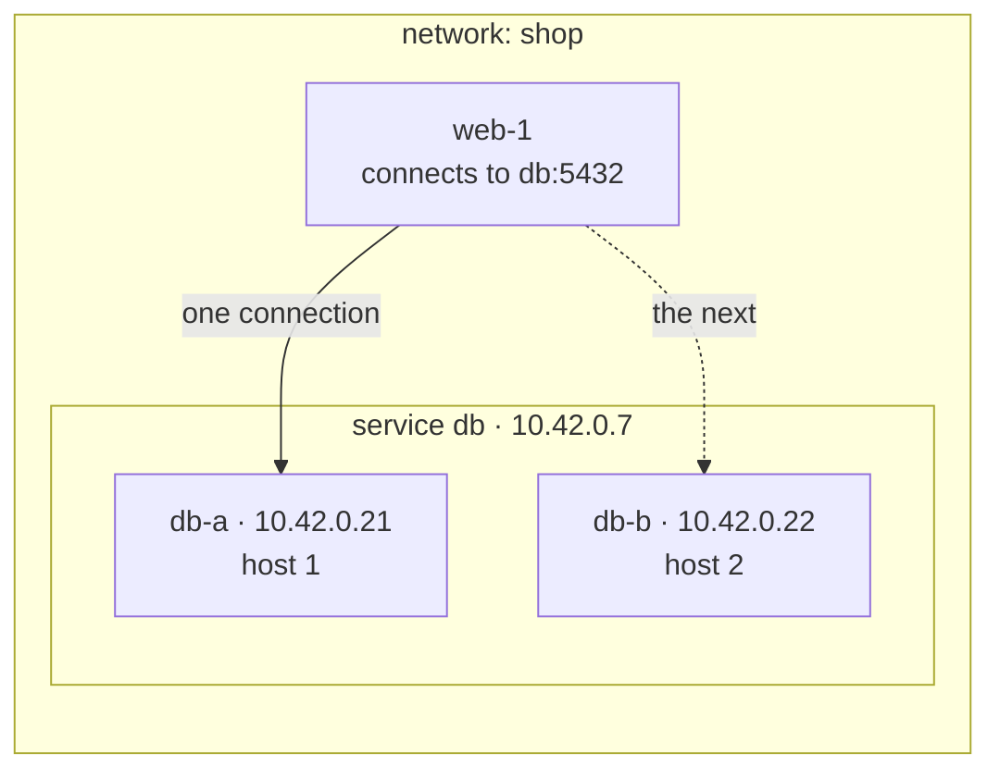
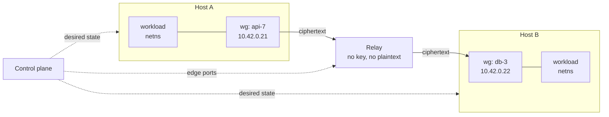

# wirenet

Per-workload network identity for short-lived workloads, across hosts in different places, with nothing on the path between two workloads able to read a packet.

A network is an isolated address space. A service is a stable name and address within it. An interface is a leased, cryptographically identified attachment that belongs to a workload rather than to the host running it. Encryption happens at both edges in kernel WireGuard; the relays between hosts forward ciphertext and hold no key that can read or forge it.

**In use:** you attach workloads to a service, and every workload that policy allows reaches them by the service's name.



1. Create a network. It costs nothing until something attaches to it.
2. Declare a service, `db`. It gets a name and an address that last as long as the service does.
3. Attach workloads to it. Each attach mints an interface with its own address and key, and the interface joins the service's backends.
4. Allow the flow: `allow web -> db tcp/5432`. Policy denies everything it does not name.
5. A workload attached to `web` connects to `db:5432` with an ordinary socket. The name resolves to the service address, and each new connection goes straight to one of `db`'s interfaces, chosen inside the client's own namespace, with no proxy or load balancer between them.

Replacing, adding or removing a `db` workload changes which interfaces stand behind the name. Clients keep dialing the same name and address.

**Best fit:** many short-lived, isolated workloads per host — agent sandboxes, preview environments, per-tenant application stacks, CI jobs — where networks are created and destroyed by programs rather than by people.

**What it buys:**

- **Identity per workload, scoped to a lease.** Each interface holds a keypair the agent mints at attach and discards at detach, and every peer validates a decrypted packet's source against the addresses that key was granted, one per family. A host speaks as the interfaces it currently holds and as nothing else, and revoking a lease removes the key from its peers rather than asking the holder to stop.
- **Overlapping address spaces at no cost.** Two networks both using `10.42.0.0/16` need no translation, no tenant tag, and no second encapsulation layer, because no two networks share a kernel object.
- **Density.** Kernel WireGuard costs a netdev and a peer table per interface rather than a userspace daemon, which is what makes an interface per workload affordable at thousands per host.
- **Service discovery without a discovery service.** Attaching a workload to a service registers it, so the control plane already knows every service's backends and pushes them to the hosts that need them. A client resolves the name through the agent's stub resolver and connects with an ordinary socket, with no Consul, sidecar or client library. A backend counts as healthy while its lease is live and its interface is up; application health checks are out of scope.
- **Selection without a load-balancer hop.** A client picks a service's backend in its own namespace, so a service address needs nothing in the middle to resolve it.
- **Change that lands in one step per client.** Each namespace applies a service change as a single nftables transaction, so no client observes a partial set of backends, and established connections drain rather than break.
- **Throughput per resource against a terminating gateway.** A gateway that decrypts and re-encrypts does two crypto operations per byte and becomes its network's ceiling. Relaying ciphertext instead is measurably cheaper; see [Measured](#measured).

**What it does not buy:** a relay that forwards ciphertext without holding a key is not unusual. Tailscale's DERP, Nebula's relays and NetBird all do it. The comparison that favors this design is against designs that terminate WireGuard in the middle, not against the better overlays.

## Alternatives

| Option | Choose it when |
|---|---|
| **Tailscale** | You need one client on every OS, including laptops and Windows, with NAT traversal solved. Its services give a stable address several nodes advertise; its userspace data plane costs a daemon per node, and DERP already relays ciphertext without keys. |
| **Nebula** | You want a mature, self-hosted mesh with host certificates and lighthouse-mediated discovery, and host-level identity is the right granularity. |
| **Netmaker / NetBird** | You want managed WireGuard between machines you administer, with a dashboard and gateways. |
| **Cilium cluster mesh** | Your workloads are Kubernetes pods and you want policy and identity inside that model. |
| **SPIFFE with a service mesh** | You want workload identity and mTLS at L7, you can change how applications dial each other, and you do not need overlapping L3 address spaces. |
| **A cloud VPC** | Every workload runs in one provider's region and you want no agent. |
| **Plain WireGuard, hub and spoke** | One operator, one network, a few hosts, and a gateway's throughput is enough. |

## Model

```text
Network    address space, isolation boundary, policy, lifetime
Service    stable name and addresses; the unit users name and policy references
Interface  one attached workload: its own addresses, keypair and lease
Lease      a binding of (interface, public key, host) with a TTL
```

A service holds zero or more interfaces, and its address outlives all of them. An interface's address lives exactly as long as its lease, so replacing a workload mints a new interface with a new address and key under the same service address — the service is what moves, the interface is what gets replaced.

A network holding no attached interface on a host costs that host nothing. Creating ten thousand networks is ten thousand control-plane rows and no kernel objects.

## Architecture

### Components

- **Control plane.** The only stateful component. Stores networks, services, interfaces, leases, policy, and relay assignments. It sits outside the data path: losing it freezes change and does not stop traffic.
- **Host agent.** One per host. Mints interface keys, creates and configures kernel WireGuard devices, installs policy, serves name resolution, renews leases, and reconciles kernel state against pushed desired state.
- **Relay.** A UDP forwarder with one port per directed policy edge. Holds no key that decrypts or forges traffic, and sees no plaintext.



### Address space

Every network has an IPv6 prefix, by default a ULA `/64`, and may also declare an IPv4 prefix. Spaces overlap freely between networks because no two networks ever share a kernel object.

**Every service has IPv6; IPv4 is opt-in per service.** A service that opts in gets an IPv4 service address, and every interface it holds gets an IPv4 address beside its IPv6 one. Family belongs to the service rather than to the interface because translation cannot cross families: an IPv4 service address translates only to IPv4 backends, and every slot in its map must carry one. A flow uses IPv4 only between two services that both have it. Which family a client dials is up to its resolver library, so policy and selection behave identically in both.

Service and interface addresses come from one pool per family and are unique within the network, so an address means the same thing in every namespace that sees it and a capture needs no context to read. IPv6 never runs short: a `/64` lets the allocator avoid reusing an address for the life of the network. IPv4 does, which is why it is opt-in. An IPv4 prefix wants a `/16` or larger, and even that is tight under churn: at 100 attaches a second a `/16` exhausts in about 11 minutes, so IPv4 addresses have to be reused.

| Purpose | Lifetime | Appears on |
|---|---|---|
| Interface address | The lease, plus quarantine | That interface, and in peers' `AllowedIPs` |
| Service address | The service | No interface anywhere |

**A released address and its relay ports stay quarantined**, but for different reasons and on different clocks.

An address does not need to outlast a partition. A peer that has yet to converge still holds the *old* key, and keys are not reused, so it cannot reach whoever holds the address next. The hazards are local to each host: installing a peer whose `AllowedIPs` contains an address silently moves that address away from the peer that held it, and conntrack entries translated to it outlive the peer entirely. Both are fixed by ordering — on every host, remove the old peer, flush its conntrack entries and destroy the sockets addressed to it before any new peer may claim the address — which leaves the address quarantine only needing to cover convergence once the holder drains. It runs from the drain, not the release: peers route the address until the drain, and a control plane that was down drains late, so a quarantine counted from the release could free an address its holder's peers still route. It is 2 minutes, after a 30-second grace period. An agent that learns of an address's new owner while it still holds the previous one as a peer waits for the holder to go before installing the new owner.

Relay ports do need the long quarantine, 5 minutes, because a stale sender keeps sending to the old port whatever the control plane has done. That makes ports the scarcer pool; see [The relay](#the-relay).

A service address exists only in clients' namespaces as a translation target. It is never assigned to an interface, never announced, and never routed, so service addresses can be minted freely and cannot conflict with a workload's own configuration.

The underlay may be IPv4 or IPv6 independently of the overlay, so either overlay family runs over either underlay.

### The interface

The host agent builds the whole data plane for a workload before the workload exists, then hands over a finished namespace:

1. Mint the interface's keypair. The private half never leaves the host, and the control plane is told only the public half.
2. **Create the kernel WireGuard device directly into the workload's namespace**, with `IFLA_NET_NS_FD`. The device records the *requesting* socket's namespace as the one its encrypted UDP socket belongs to, so the plaintext side lands in the workload's namespace while ciphertext leaves through the host, with no move ([WireGuard namespaces](https://www.wireguard.com/netns/)).
3. Set the private key and a fixed listen port.
4. Install one peer per policy-connected interface: its public key, its endpoint, and as the only entries in `AllowedIPs`, its address in each family both interfaces have.
5. Assign the interface's addresses, route the network's prefixes through the device, and set the MTU explicitly.
6. Install the nftables table: service translation, policy, and MSS clamping.
7. Open a stub resolver socket on loopback inside the namespace, at `127.0.0.53:53`, served by the agent.
8. Hand the namespace to the workload **without `CAP_NET_ADMIN`**. The local API answers the attach only once step 7 has run and the slots step 6 holds back for peers not yet ready are in, so a workload that resolves a name and dials as it starts is answered at once; see [The relay](#the-relay) and [Paths](#paths).

Creating into the namespace rather than creating and then moving is worth 6.3× on attach, because a namespace move waits on an RCU grace period inside the RTNL lock and so barely overlaps under concurrency. See [Measured](#measured).

`AllowedIPs` carrying one address per family per peer is the identity enforcement: WireGuard validates the source address of every decrypted packet against the sending peer's entries, so no peer can send as an address it was not granted. It also keeps the cryptokey table unambiguous: WireGuard keeps one trie per family (`drivers/net/wireguard/allowedips.h`), and each resolves an address to exactly one peer.

The namespace is the unit of isolation, so the model applies wherever a workload can be put in one: a container, a VM, or a bare process under `ip netns exec`. For a microVM or VM behind a TAP, the interface address belongs to the **guest**, not to the namespace — addressing the namespace instead would capture the guest's own packets — so the namespace routes between the TAP and the WireGuard device rather than terminating the address.

### The relay

A relay forwards outer UDP packets. **One port per directed policy edge**, on every relay in the network's set, so the port a packet arrives on names its sender. Each direction learns one endpoint from the packets arriving on its own port:

```text
pushed:   port -> its peer port, the interface entitled to send on it,
                  and that direction's registration key for this relay
state:    port -> the endpoint its last accepted registration named,
                  and the highest counter accepted
```

A packet arriving on port `P` from endpoint `E`:

1. An unknown `P` drops. The relay binds a socket only for ports its table holds, so the kernel drops these before the relay sees them.
2. A registration datagram is verified against the direction's key and counter. On success it is written to the relay's log, then sets this direction's endpoint to `E`, or clears it if the registration is a withdrawal, and is consumed rather than forwarded.
3. Any other packet from the direction's registered endpoint is forwarded from the peer port's socket to the endpoint the peer direction last registered.
4. A packet that arrives before the registration that would admit it — its own direction's from `E`, or the peer direction's — waits up to 2 seconds and goes out, in arrival order, once that registration commits. One still waiting then drops. At most eight wait per port and 65,536 per relay. Each port counts its own waiting packets, so admitting one costs the same however many wait, and a commit looks only at the ports it touches: 43ns at 64,000 waiting on the Core Ultra 9.
5. Within a second of either direction gaining a new endpoint, a WireGuard handshake initiation from one end drops if the relay sent the other end's on within that second, to this end's current endpoint, and this end has not answered it with a response or a cookie reply. Of two waiting initiations one commit lets through, the one that waited longer goes.

The relay reads datagrams up to 9,032 bytes, the largest overlay MTU plus WireGuard's 32, and drops a longer one, which the kernel would truncate, rather than forward a prefix.

So a data packet never moves an endpoint. Only a registration does.

Sending from the peer port is what makes the return path work without configuration: the receiver sees the packet arrive from exactly the port it addresses the sender at, so WireGuard's roaming keeps both sides pointing at the relay.

**Directed ports exist so that the relay never has to recognise a sender by address.** A host behind NAT has no outbound address the control plane can know in advance, and many have none that is even stable — a microVM substrate that reassigns a public address on each resume is common. Two interfaces can also share one NAT address, which an address-based scheme cannot disambiguate at all. Doubling the ports per edge buys exactness.

**A direction's first packets race the relay's table, so the agent waits for the relay, and the relay holds what still arrives early.** The relay and the agents learn of a new edge from the same commit, and an attaching agent learns of it first, in the attach answer itself, while the relay waits on its poll. A relay binds a new edge's port only once it loads the table naming it, and the kernel drops anything sent to a port no socket holds: across 30 attaches at degree 20 in the lab, the relay's kernel counted 241 datagrams to ports it had yet to bind. A dropped handshake initiation costs WireGuard a 5-second retry, and in one end-to-end run in three a workload that dialed as soon as its attach returned first reached a remote peer after 5.27 seconds. So:

- **Registrations are resent until acknowledged.** Each agent sends a registration for every direction as it installs the peer, then up to five more times to each relay yet to acknowledge it, the first after 10ms and each gap three times the last.
- **The relay acknowledges what it commits.** Once a registration is durable and committed, the relay sends its sender a 16-byte acknowledgment from the direction's own port: magic `0xff 'S' 'D' 'A'`, version 1, three zero bytes and the counter. The agent's raw sockets carry a filter that passes acknowledgments alone. An acknowledgment carries no MAC: a forged one can only end an agent's wait early, which costs the handshake retry the wait exists to avoid, and an acknowledgment is half the size of the registration that earns it.
- **A relay peer new to a namespace takes no new flow until the relay its edge sends through acknowledges it**: no slot names it, and the namespace's table rejects a dial to its own address, as a member's name gives ([Paths](#paths)). An attach is answered only once its namespace's slots are in. Both waits end after a second whatever arrives, so a relay that is down delays an attach by at most that. A peer no slot names holds nothing back, but the attach waits for it too: a backend's answer then means the relay holds its edges' ports, so an orchestrator that removes the old backend once the new one answers strands no client. A peer installed before, such as one adopted at start or one a failover moves to another relay, never waits: edges hold ports on every relay in the set from the start.
- **The relay holds what races the other side.** The two agents of an edge install it at different moments, so an initiation can still reach a bound port before the peer direction's registration commits; the relay holds it for that registration, as step 4 describes, rather than drop it.
- **The relay passes one of two crossing initiations.** Two workloads that dial each other as their edge forms, as a starting etcd member and its leader do, send first initiations at once, and the hold lines them up: each end's waits for the later registration, which releases both together. Crossed, they both fail. Each end answers the other's initiation, which discards its own (`noise.c`), and having answered may not initiate for 5 seconds (`send.c`). So the relay drops the second, as step 5 describes, and that end answers the first instead. An end that answered sends no initiation for 5 seconds, so one that has not answered sent its own before the other's arrived, or never received the other's. An end under load answers with a cookie reply, which leaves its own handshake whole, so the relay counts that as answering; and an initiation the relay sent before an end's endpoint changed went to the old endpoint, so it crosses nothing. The rule therefore costs a retry only when the network loses an initiation after the relay sends it, within the second after a new endpoint. A sender forging an end's source can suppress the other end's initiations only for the second after a new endpoint, since the relay judges crossings no later. Crossings are likeliest while an edge forms slowly. When a batch registered its new peers only after flushing the ones it removed, a replacement's edge took the whole flush to form: on EC2, without the rule, a replaced etcd member's first connection waited 5,051ms in all 10 rounds of a run, against none of 20 rounds with it. With registration ahead of the flush, the window narrows to the batch's rule swap and peer removal, and without the rule 1 of 20 rounds still waited 5,029ms. An end-to-end test replaces a member 40 times while it and a peer dial each other, the peer every millisecond. The relay dropped a crossed initiation in 10 of 200 rounds over five runs, since a peer new to a namespace now dials only once its relay acknowledges it; before that, in 10 of 80 rounds, and while the flush came first, in every round, where without the rule every round took 5.15–5.17 seconds. The lab's hosts share one kernel, and so one timer wheel, so crossed ends there could retry on the same tick and stay apart for 25 seconds.

Consequences:

- **No crypto, no conntrack, no per-flow state.** One table lookup, one endpoint record, and a send. Reads and writes must be batched through `recvmmsg`/`sendmmsg`: a per-packet syscall loop overflows its receive queue and carries less traffic than a terminating gateway, which removes the reason to relay at all.
- **An endpoint change is admitted only by an authenticated registration datagram.** The agent sends one to every relay in the network's set, carrying a monotonic counter and a MAC over it *plus the relay's advertised address and port*, which name the direction. Three properties the design depends on:
  - **The key is derived per relay**, from the direction's secret and that relay's identity, and each relay receives only its own. A single shared secret would let a compromised relay compute valid registrations for its peers by naming their address in the MAC. The control plane mints a secret per direction when it creates an edge, pushes each relay its derived key in the port table, and gives the sending interface's agent the secret, from which it derives every relay's key.
  - **The counter survives restarts at both ends.** The relay persists the highest counter it has accepted per direction; the agent's counter is its clock in milliseconds, kept rising within a run. Otherwise a relay restart reopens replay, and an agent restart locks the agent out of its own direction.
  - **It is sent on change, not only on a timer.** The periodic interval is 25 seconds, under common NAT UDP timeouts and the figure `wg(8)` recommends for keepalive, because on the relay path this datagram is the only thing holding the NAT mapping open. A periodic send alone would leave recovery waiting up to that long after a resume or an address change, so the agent also sends at once when an underlay address changes, at most once a second; a change inside that second sends when it ends, so the address the host settles on registers. An IPv4 registration carries a zero UDP checksum, which IPv4 allows (RFC 768), since the agent cannot know which source address the kernel will pick after a change. The steady cost is edges × relays ÷ interval.

  The datagram is 32 bytes:

  ```text
  0:4    magic 0xff 'S' 'D' 'R'
  4      version 1
  5      kind: 0 claims the sender's address as the direction's endpoint,
         1 withdraws the endpoint
  6:8    zero
  8:16   counter, big-endian
  16:32  HMAC-SHA256 over a label, the relay's advertised address and port,
         and bytes 0:16, truncated to 16 bytes
  ```

  A WireGuard message begins with a type from 1 to 4 followed by three zero bytes, so the first byte alone tells a registration from traffic. A relay verifies a registration under the key its table held when the registration arrived and commits it only if that key still holds, so a registration for a port that was reallocated meanwhile commits nothing. A port accepts 20 verified registrations a second, and the relay verifies at most 50,000 failing ones a second in all. Only failures spend the second budget, so junk cannot spend an owner's, and only a relay-wide flood past it delays an endpoint change.
  Verifying a WireGuard handshake's `mac1` is **not** sufficient and was rejected: `mac1` is a fixed MAC over the message bytes, covers no destination, and the timestamp that would make it fresh is encrypted, so a captured initiation replays from any address and at any relay — and every peer of the receiver already knows the public key that keys it, so an insider forges outright.
  A packet that loses an endpoint race is dropped rather than forwarded, so the relay cannot be used as a reflector.
- **A relay persists what it is pushed and what it accepts.** Its port table, per-direction keys, endpoints and highest counters survive a restart, or a relay that comes back during a control-plane outage strands every edge it serves. Every accepted registration is appended to a log and synced, with concurrent writes committed as a group, before it moves an endpoint; a state file rewritten every 10 seconds truncates the log. A registration verified under a table the state file lacks writes that table first. Opening the log cuts a torn last line, so the next append starts a fresh one.
- **A restart costs only its downtime.** The relay reloads its table, endpoints and counters from disk and binds its sockets, so traffic resumes with no registration sent. A port that fails to bind is logged, counted and retried every 5 seconds and on each new table; the other ports serve.
- **The probe port answers at most 50,000 probes a second across the relay**, since a probe's source can be forged. That covers 10,000 agents probing every 200ms; a relay serving more must raise it, or its agents will read the cap as an outage and fail over.
- **Zero added bytes**, so the overlay MTU accounts for WireGuard overhead alone.
- **No key, no plaintext, ever.** A relay can be run by someone the workloads' owner does not trust with data.

A relay carries several addresses, so the table keys on `(local address, port)`. Two limits bind, and both are tighter than they look:

- **Port supply, under churn.** Ports stay quarantined for five minutes after an edge goes away, because a stale sender keeps sending to the old port. At 100 attaches a second with an average degree of 10, two directions each, that is 600,000 live ports — more than eight IPv4 addresses supply. An IPv6 relay address space relieves it, and so would a shorter quarantine: a stale sender's registrations fail their MAC under the new direction's key, and its data packets, arriving from an endpoint nobody registered, wait and drop.
- **Socket count.** A userspace relay opens a socket per directed port, so one process serves thousands of edges rather than the hundreds of thousands the port space allows. `sk_lookup` fixes the receive side only; sending from the peer direction's port still needs a socket bound to it or a raw socket, so the userspace route is `sk_lookup` plus raw sends, while XDP or TC handles both in one place. This is a correctness requirement for the stated scale, not a speedup.

Edge ports are allocated on **every** relay in a network's set up front, because an agent can only fail over to a relay it already has an address for.

**Registration at every relay needs its own packet, because kernel WireGuard sends to one endpoint per peer.** The agent sends the registration datagram to every relay in the set on the schedule above, the one its edge sends through and the rest alike, from a raw socket bearing the interface's own listen port so the NAT mapping it creates is the one real traffic will use. The raw socket carries a BPF filter that passes relay acknowledgments alone, so it never queues the host's traffic. The relay recognises registrations by their MAC and keeps them out of forwarding. Admission and failover are therefore one protocol. Moving an edge between relays is safer than a service change, because both paths deliver throughout: allocate, push, repoint, then free the old ports after convergence.

**A draining interface keeps its edges but gains none.** **An edge that policy stops connecting goes dormant rather than away.** While both interfaces stay attached, the control plane keeps the edge's ports and secrets, so a restored rule spends nothing, and its relays keep what they hold. **An agent withdraws a relay peer's direction once its batch removes the peer:** it sends each relay a withdrawal, a registration of kind 1 above every counter it has sent, which clears the direction's endpoint. A restored rule then reconnects as a new edge does: each relay holds the returning sender's first initiation until the receiver, its peer back, claims its direction again. A relay that kept the endpoints delivered that initiation at once, to a device still without the sender's key, and in 4 of 13 lab runs of a deny lifted from 30 sandboxes a relayed sandbox waited out WireGuard's 5-second retry.

**Counters order claims and withdrawals, so every race between them ends where the agent's latest registration says once that one lands.**

- A periodic claim sent just before the agent learned of the dormancy is a replay if it arrives after the withdrawal, and is cleared by the withdrawal if it arrives before. A test delivers every ordered subset of six claims and withdrawals, one withdrawal resent, 1,957 sequences, and finds the highest counter delivered deciding the endpoint each time, before a restart and after it.
- The agent judges by state: it withdraws a direction once its desired state names the peer no more and its device no longer holds it, however the peer went, so a removal that failed partway after the kernel carried it out is withdrawn after the look that follows.
- A withdrawal is resent unchanged, on a claim's schedule, until its relay acknowledges that counter. At its own counter it never outranks a claim sent after it, so a peer restored while its withdrawal is in flight claims over it, and the claim ends the withdrawal's resends. A relay holding the withdrawal acknowledges a resent copy again without writing it, spending the port's registration budget rather than the reject budget, so a lost acknowledgment costs one resend.
- An acknowledgment counts only above the counter the agent held when its wait or schedule began, so a withdrawal's late acknowledgment neither gives a restored peer its slot nor ends its claim's resends.
- An agent cut off from the control plane never learns of the dormancy. It keeps its peers and their claims and withdraws nothing, so its directions stay registered and carry traffic again the moment the rule returns.

A race costs at most one WireGuard handshake retry, 5 seconds. Where every send of a withdrawal is lost, or the agent restarts before withdrawing, including a restart that spans the dormancy, after which no desired state names the peer's secret, the relay keeps the endpoint, and the returning sender's first initiation can reach the device before its peer does. An installed relay peer whose secret or relay ports change claims at once, as when its edge was made anew on its old ports while the agent was cut off. Nothing waits on a withdrawal, so none can stall a namespace. An edge dormant for a port quarantine is deleted, and its ports are free at once, since nothing has sent to them meanwhile.

### Paths

An interface reaches a peer by one of three paths, chosen by setting the peer's endpoint. Keys, addresses, and policy are identical in all three, so the path is an optimization rather than a mode.

| Path | Endpoint | When |
|---|---|---|
| **Loopback** | `127.0.0.1:<peer's listen port>` | Both interfaces are on the same host. Both UDP sockets live in that host's namespace, so the packet never leaves it and stays encrypted. |
| **Relay** | `relay:<this direction's port>` | The default. No inbound reachability required at either end, so NAT traversal is unnecessary. |
| **Direct** | the peer's host endpoint | Both ends are reachable, directly or after hole punching. Zero added hops. |

**Every relay in a network's set carries traffic, each edge through one of them.** Kernel WireGuard holds exactly one endpoint per peer, so an edge sends through one relay at a time, and the agent chooses it: of the relays its probes find up, the one of highest weight by `model.RelayWeight`, which hashes the edge's two interfaces with the relay (rendezvous hashing), or the heaviest of all when none answers. Both ends compute the same weights, so they choose the same relay while their probes agree, and a network's edges spread over its relays in proportion: sixteen edges over two relays split between them in every run of the end-to-end suite. A network's throughput grows with its relays; one edge's stays bounded by one relay port and by encryption at its ends. On EC2, two relays doubled what one carried, and with three the receiving hosts' encryption became the limit; see [The fleet on EC2](#the-fleet-on-ec2).

Failover is the agent's job too. It probes every relay of its networks every 200 ms, and when one misses three in a row, the edges that relay carried move, each to its own next relay, so a dead relay's load spreads over the survivors. When the relay answers again, they move back. Edges hold ports on every relay in the set, so any relay can take any edge at once.

Roaming reconciles the moments when the two ends' probes disagree, so it can also leave an edge where the last packet took it: on another relay of its set, or with each end sending through a different relay. Both still deliver. Across 2,000 simulator seeds, 9 of the 10,574 relay edges live at the end were split and 13 sat on a relay other than their heaviest; the agent leaves them there, since roaming owns the endpoint, until a relay's health next moves them. Anycasting a relay address moves failover into the network and is a later option.

**Roaming owns the endpoint, so the reconciler must not treat a roamed endpoint as drift.** Any authenticated packet from a new source rewrites it, which is the mechanism the relay path depends on. An agent that "corrects" the endpoint back to its desired value will fight the data plane.

**`persistent-keepalive` is set per path:**

| Path | Keepalive | Why |
|---|---|---|
| **Relay** | None | The registration datagram already registers each direction at the relay, and because it leaves from the interface's listen port for the same relay port, it holds the NAT mapping open too. |
| **Loopback** | Exactly one side | Keeps a session up and gives one side every rekey, so the pair cannot collide. See below. |
| **Direct** | Both sides, or an equivalent agent probe | Holds the NAT pinhole, which nothing else does on that path. |

Leaving keepalive off relay peers makes an idle peer free: it sends nothing and never rekeys, since WireGuard rekeys on a timer only for the side that initiated the session, and only when it sends (`drivers/net/wireguard/send.c`). The cost is one handshake round trip on the first packet after a session idles past its 180-second lifetime (`messages.h`), a few milliseconds through an in-region relay. It also removes a collision at attach. Arming keepalive on a running device sends a packet at once (`netlink.c`), and both agents install a new edge within milliseconds of each other, so two armed peers each initiate immediately; initiations that cross within the relay's one-way latency cancel each other and cost a 5-second round, more than the attach target allows. Without keepalive, only the side with traffic initiates.

This rests on a raw-socket registration datagram refreshing the same NAT mapping that WireGuard's own socket uses. A NAT keys its mappings on addresses and ports rather than on the sending socket, and a conntrack NAT built from namespaces confirms it: behind a NAT that forgets an idle UDP mapping after 3 seconds, a relay peer with no keepalive still answered at once after 8 idle seconds, and when the NAT dropped every mapping and assigned new ports, the next registration moved the endpoint and traffic resumed in 0.7s.

The loopback path makes co-location a real placement objective: two services that talk constantly cost nothing to connect when scheduled together.

**On the loopback path, at most one side initiates.** One agent configures both ends of a co-located pair, so if both peers carry `persistent-keepalive` they initiate at the same instant. Each answers the other's initiation, which discards its own pending handshake, and both responses come back invalid. WireGuard retries after 5 seconds plus up to 333ms of jitter (`drivers/net/wireguard/timers.c`), but at `HZ=1000` a timer that far out sits in a timer-wheel level that rounds expiry to 512ms (`kernel/time/timer.c`), so the two retries usually fire on the same tick again. On Linux 7.0 a pair stayed in that lockstep for minutes. So exactly one side of a co-located pair arms keepalive: the side that reaches the other, counting the development machines a gateway fronts, or the lower ID when each reaches the other. That side keeps a session up and owns every rekey. The reaching side matters while the pair forms, because arming sends an initiation at once and a client's first connection sends one too. From two devices those cross the same way: each side answers the other's initiation, which discards its own (`noise.c`), drops the answer to its own, and having answered may not initiate for 5 seconds (`send.c`). When the lower ID chose, db kept the pair alive about half the time, and a sandbox co-located with it waited 4.75 seconds in 2 of 28 lab runs of a deny lifted from 30 sandboxes; none did in 59 runs since. From one device, the connection finds the keepalive's handshake in flight and waits for it. When each side reaches the other, the side without keepalive could still cross it, so that side takes no new flow toward the peer, by slot or at the peer's own address, until its device holds a session with it, or until AckWait passes from when the other device holds the reverse peer. The agent reads the peer's last handshake at gaps doubling from 2ms to 128ms, since each read takes RTNL, and a read that fails ends the wait. In a root test that armed one side's keepalive as the other dialed, 29 of 40 rounds took over a second without the wait and none with it. **Nothing sends toward a co-located peer until the other device holds the reverse peer.** A device drops an initiation from a key it has no peer for, and WireGuard waits 5 seconds before trying again, rate-limiting every initiation in between (`send.c`). The agent configures the two namespaces concurrently, so either side can install first. Three things would send early:

- **Arming keepalive**, which sends an initiation at once (`netlink.c`). The keepalive side installs its peer unarmed and arms it in a later batch.
- **A slot naming the peer**, which turns a workload's next connection into an initiation. A client's slots for a co-located backend wait the same way, so the backend joins that client's map only once its device holds the client.
- **A dial to the peer's own address**, which a member's name gives and no slot carries. A namespace's table admits a new flow into the network's prefixes only to the namespace's own addresses and to the peers a slot may name, those of services it reaches whose waits have ended, and rejects any other at once, as it does a service with no backends; replies pass, since they belong to established flows. A dial to a peer the namespace does not reach would fail at the peer's inbound chain anyway, and its initiation could still cross the peer's own. The workload's next attempt goes through once the peer opens. Before the table held such dials back, co-located members dialing each other by name every millisecond crossed in 10 of 200 rounds of an end-to-end test, and both ends waited 5.1 seconds: the waiting side's dial sent its initiation within half a millisecond of the other side arming keepalive, and WireGuard's debug log showed each end answer the other's initiation and both answers fail. None has crossed in 600 rounds since.

The agent judges the other namespace by the peers it believes are installed there, less any a batch running there removes, and replans the waiting namespaces whenever a batch completes. Without this, in the lab, every client co-located with a freshly attached backend that sent before the backend's namespace was configured reached it only after 5.2 seconds. Leaving both sides bare would let two workloads that start sending at the same instant after an idle period fall into the same lockstep. Peers on different hosts keep separate clocks and do not lock together this way. Their first initiations still cross most often as their edge forms, which the relay settles ([The relay](#the-relay)); a crossing later costs a 5-second round.

### Service addresses and selection

Because relays carry ciphertext, nothing in the middle can read an inner destination address. Selection therefore happens in the client's own namespace, which removes the load balancer hop entirely.

The agent installs, per service the client may reach:

```text
table inet wirenet {
  map db_slots { typeof numgen random mod 1024 : ip daddr; }
  chain services {
    type nat hook output priority dstnat;
    ip daddr 10.42.0.7 tcp dport 5432 \
      dnat to numgen random mod 1024 map @db_slots
  }
}
```

The slot count is fixed for the life of the service, which is what makes a backend change cheap:

- **A backend is one interface**, one attached workload. A single-instance service owns every slot; five replicas own a fifth each, wherever they run. A backend's weight is how many slots it holds.
- **The declaration uses `typeof` on both sides.** `typeof <key expression> : ip daddr` is the form nftables accepts. Naming a value type (`: ipv4_addr`) or an unqualified `type integer` key are both rejected, the second with advice to use `typeof`. The agent builds the same map for IPv6 with an `ip6 daddr` value, and the kernel tests translate by traffic in both families.
- **An IPv4-capable service has one map per family.** A map's values are all one family, so the agent installs an IPv6 map and an IPv4 map, and both assign each slot to the same backend. A backend's weight is then the same whichever family a client dials, and one transaction changes both maps.
- **The map always holds every slot**, and a change replaces only the entries whose backend moved. `delete element` and `add element` in one nftables batch apply atomically. A slot with no entry leaves the packet addressed to the service address, which goes nowhere, so a partially filled map is never written.
- **Removing a backend disturbs only its own slots**, because the slot table is the indirection layer.
- **A service with no backends rejects** rather than blackholing: the agent installs a reject rule for the service address instead of a translation, so a client fails fast rather than hanging.
- **So does every service the namespace has known that policy now keeps it from.** A rejected connection leaves conntrack nothing. One sent untranslated, as to a service the namespace has no rule for, leaves an unreplied entry for 120 seconds, and NAT runs once per entry (`nf_nat_inet_fn`, `net/netfilter/nf_nat_core.c`), so a later connection whose tuple lands on it misses the service's translation once policy restores it, and the reject refuses it. A deny drops the service from the host's state if no interface there still reaches it, while the workload keeps the address it learned, so each host's state also lists the addresses of the network's services none of its interfaces reaches, and every namespace rejects those along with the host's other services. The list changes only as services come and go, and survives an agent restart. The reject lists are a set per family, so every packet meets at most four reject rules in each chain it passes however many services the network holds. Before this, 4–8 of 30 sandboxes took 0.15–1.0s to reach db again in 4 of 10 lab runs of a lifted deny, refused on the tuples their own denied connections had left; deleting those entries once the service translated still left 0.13s, the time 623 deletions took, in 6 of 45 runs. With the reject, none of 40 runs took over 17.3ms.
- **The ceiling is the slot count**, which you pick. 1024 is past any real replica count, and a map that size is trivial for the kernel.

A namespace holding a forwarding workload, such as a microVM behind a TAP, gets the same rules in the `prerouting` hook.

- **Selection is per connection.** Conntrack pins the first packet's choice for the life of the flow, for TCP and UDP alike. `numgen random` draws each connection's slot independently (`nft_ng_random_gen`, `net/netfilter/nft_numgen.c`), so a backend's share converges on its slot count, and it has no affinity to disturb. `numgen inc` reads as round-robin but concentrates load: each rule owns its counter and starts it at slot 0 (`nft_ng_inc_init`), so every client namespace begins on the same backend, and short-lived clients that open a few connections never leave it. On nftables 1.0.9 and Linux 6.10, twenty fresh namespaces opening one connection each all reached one backend under `inc` and split 8 and 12 under `random`. A map declared `typeof jhash ip saddr mod 1024 : ip daddr` keys selection to the client instead, which preserves affinity across reconnects and, because the slot table absorbs the change, moves only a departing backend's share — consistent-hash behavior, but only in the `jhash` form. Affinity holds within one family, since a client's IPv4 and IPv6 addresses hash to different slots. `numgen random` is the default because `nft list` segfaults while printing a `jhash`-keyed map on nftables 1.0.9: the ruleset works and the inspection tool crashes.
- **Replies need no reverse lookup.** Conntrack untranslates them, so the application sees responses from the service address it dialed.
- **The server never learns the service address.** It replies from its own interface address, which is also its identity to the policy engine. Incoming and outgoing identity are the same thing.
- **Names resolve to service addresses** through the stub resolver on loopback, answered from pushed state. It answers AAAA for every service and A only where both the client's service and the target have IPv4, so no client receives an address it cannot reach. Because the agent serves it, an agent restart would interrupt name resolution for every workload on the host: persisting the resolver's state alone cannot help, since the listening sockets close with the process. The agent keeps each namespace's listening descriptors in systemd's descriptor store instead (`FDSTORE=1`), and takes them back from `LISTEN_FDS` when it starts, so a query sent while it restarts waits in the socket buffer. Each namespace forwards at most 64 UDP queries to the upstream at once, off the loop that answers local names, and holds at most 16 TCP connections; past either, a query or connection is dropped and its client retries.

### Named members

A service's members can hold names, for software whose members address each other one by one, such as etcd or a database's replicas. An attach may name a member, a DNS label, and `<member>.<service>.<network>.internal` then resolves to that interface's own addresses, wherever the service's name resolves and in the holder's own namespace, since clustered software often resolves its own advertised name as it starts. A member is otherwise an ordinary backend: rules name services, so members inherit their service's policy, and the service address spreads connections over every backend, named or not. So an etcd cluster is one service with `allow etcd -> etcd` for its peers, and its clients use `etcd.<network>.internal`.

- **At most one live interface holds a name.** An attach naming a held member fails with a conflict, so an orchestrator retrying a host it wrongly believes lost cannot make a second holder. A name frees when its holder's lease ends, by release, revocation or expiry, so a draining interface holds none. Postgres enforces the rule with a partial unique index over live holders, and the memory store checks it the same way.
- **`replace` revokes the holder in the same transaction**, so the name is never vacant and two attaches cannot race for it. Revocation removes the holder from every peer at once, so the replaced process reaches nothing once hosts converge on the revision, which a StatefulSet cannot do for a pod on a lost node. An attach retried with `replace` returns its own interface.
- **The name answers the holder's interface address, which changes when a member moves.** Kubernetes' headless services answer the same way, so clustered software expects it: the holder binds to, sends from and advertises a real address. A stale answer reaches no one, since the resolver's TTL is 5 seconds, IPv6 addresses are never reused, and an IPv4 address waits out its quarantine. A stable address per member that outlives its holder, for software that caches a resolved address past its TTL, is a later option.
- **A dial to a member's name waits as a slot does.** The name answers the holder's own address, which no slot carries, so a namespace's table opens a peer's address to new flows only once a slot may name the peer, and rejects a dial made sooner at once ([Paths](#paths)). Before the table held such a dial back, a peer sharing a host with a new member could dial it as the member's device armed keepalive, and their first initiations crossed: in 1 of the first 40 such rounds in the lab, etcd-3's first connection to a moved etcd-2 waited 4.99 seconds.
- **A name above a member's exists.** A member whose service may not reach itself still answers its own name, so its zone holds `etcd-1.etcd.<network>.internal` without `etcd.<network>.internal`. The resolver answers the name above with no records rather than NXDOMAIN, which a resolver following RFC 8020 would read as covering every name below it.
- Only workloads hold names.

Moving an etcd member to another host is measured in [The whole system on one machine](#the-whole-system-on-one-machine) and [The fleet on EC2](#the-fleet-on-ec2). etcd has a race of its own there. A new member applies the leader's snapshot by stopping and redialing every peer connection (`applySnapshot`, etcd's `server/etcdserver/server.go`), and a first attempt to publish itself to the cluster that began before can time out; etcd logs it as a lost connection and retries after 7 seconds. It happened in 18 of 70 rounds on EC2 and in 42 of 80 in the lab.

### Policy

Policy is written against services and compiled per interface:

```text
allow api -> db       tcp/5432
allow web -> api      tcp/8080
allow api -> internet tcp/443
allow *   -> mirror   tcp/443
deny  box -> billing  any
```

**A rule allows or denies, and either side may be `*`.** `*` stands for every service in the network but the one on the rule's other side, so `allow * -> mirror` opens the mirror to every other service and `allow box -> *` lets the sandboxes reach every other service, and neither lets a service reach its own members. Traffic within a service takes a rule naming it on both sides, `allow box -> box`, because a service connected to itself peers every two of its members, a cost that grows with the square of its size, and opens lateral movement between them. `internet` is a destination only. A wildcard applies to services created after it.

**A deny takes the flows it names out of every allow, whatever the order.** For each directed pair of services, and for each service's egress, the control plane resolves the rules into grants when it compiles a network: what some allow names less what any deny names, exact over TCP ports, UDP ports and every other IP protocol. `allow a -> b any` with `deny a -> b tcp/22` leaves TCP but port 22, all of UDP, and every protocol but TCP and UDP, which nftables matches as `meta l4proto != { tcp, udp }`. Grants are disjoint, and a pair whose flows add up to everything compiles to one grant for any protocol. A pair allowed in one direction keeps its peers, and the denied direction loses only the receiver's accept; a pair with no grant either way loses its peers, and its edge waits out the port quarantine like any disconnected pair's. `GET /v1/networks/{net}/policy` and `wirenetctl policy NET` list the grants.

A wildcard is a fan-in: `allow * -> db` peers every interface of the network with every db backend, so a db backend's peer count, and the relay ports its edges hold, grow with the network.

Compilation produces two things, and default is deny:

- **A peer set.** An interface receives a peer only where some grant permits a flow in either direction. **The policy graph is the peer graph**, so an interface's peer count is its policy degree rather than the network's size. Peer count costs memory always, and handshakes only where traffic flows. A relay peer carries no keepalive, so an idle one sends nothing and never rekeys; a busy one rekeys about every two minutes, so 2,000 busy peers cost about 17 handshakes a second. Each co-located pair adds one rekey every two minutes from its keepalive side.
- **nftables sets in the receiving namespace.** Which flows are permitted, by service-grouped address set and port. A set holds one family, so the compiler emits each in every family the two services share, and a rule permits the same flows in both. Installed before handover and unreachable from inside, so the workload cannot remove them.

`AllowedIPs` answers "may this peer speak as this address." nftables answers "may this flow happen." Both run in the kernel at the receiver, so removing the relay from the trust path costs no enforcement.

**Attach latency grows with policy degree.** Peers install at roughly 130µs each in one batched call, so an interface joining a fully connected 2,000-interface network waits about 250 ms for its own peer table before it can talk to anyone. Dense policy is expensive at attach even when it is affordable at steady state.

**Internet egress is a separate grant, and it is the one case where a namespace has a second way out.** A grant names protocols and ports on the interface, such as `tcp/443`. The agent adds a veth pair, `eg0` in the namespace and `wne<listen port>` on the host, routes the namespace's default through it, and masquerades on the host; without the grant no such path exists, which is what gates egress. The filter lives in the **host** namespace, in table `inet wirenet_egress`, and drops before any grant applies:

- loopback, link-local and the metadata services in both families (`169.254.169.254`, on EC2 `fd00:ec2::254` inside `fc00::/7`, and Azure's `168.63.129.16`);
- private, shared, multicast and reserved ranges in both families;
- **the host's own prefixes**: each address's prefix and each route the host reaches without a gateway, such as the `/64` an EC2 host learns from router advertisements while its address is a `/128`, recomputed whenever an underlay address changes;
- every relay address;
- the NAT64 form of each blocked IPv4 prefix (`64:ff9b::/96`, RFC 6052), and the local-use NAT64 prefix `64:ff9b:1::/48` whole, so a NAT64 gateway reaches none of them;
- anything addressed to the host itself, but for the IPv6 neighbour discovery the link needs.

Each blocked prefix's rule carries the prefix as its comment, which `nft list` shows, so the filter records what it blocks. An agent that restarts keeps every prefix the filter held, relays included, until it holds desired state again, however long the control plane stays away. Refreshes run one at a time, so an older set never lands after a newer one, and a failed refresh retries until it succeeds or a newer set replaces it.

The host matters as much as the rest: the veth's host end otherwise reaches host services and every co-located interface's WireGuard listen port, where a flood of handshake initiations costs the host a Curve25519 operation each. A workload that can reach the relays can attack endpoint registration. What passes the filter meets the link's own grant, reached through a verdict map keyed by the link's name, so a grant change rewrites one chain. Nothing outside may open a flow into an egress link; only replies return. Each rule of a grant records the flow it admits as its comment, so an agent that restarts reads back what it installed however many flows the grant holds. A chain whose rules record nothing, as an agent that kept the grant in the link's alias wrote, reads as an empty grant; no desired grant is empty, so the agent rewrites it. Tearing down an interface whose namespace is already gone removes the host side by its index.

The veth carries per-host addresses outside the network's prefixes, derived from the listen port: a `/31` in `100.64.0.0/10` and a `/127` in `fdff:e9e5::/64`, so a service without IPv4 still reaches the IPv4 internet. IPv6 egress is masqueraded like IPv4, because the network's IPv6 addresses are ULAs, and is offered only on a host that already forwards IPv6: turning IPv6 forwarding on would stop the host accepting router advertisements on its own uplink. The agent turns on IPv4 forwarding, which egress needs. A granted namespace's stub resolver forwards names outside the network to the host's upstream resolver.

### Development machines

A developer joins a network from a laptop with a stock WireGuard client, such as the macOS app or `wg-quick`, by importing a generated config. The laptop becomes an interface like any other, with its own key, addresses and lease, and policy names it like any other.

```ini
[Interface]
PrivateKey = <minted on the laptop>
Address = fd8a:2c41:7e09::51/128, 10.42.0.51/32
DNS = fd8a:2c41:7e09::3, shop.internal
MTU = 1380

[Peer]
PublicKey = <the gateway interface's public key>
Endpoint = gw.example.com:51820
AllowedIPs = fd8a:2c41:7e09::/64, 10.42.0.0/16
PersistentKeepalive = 25
```

- **The laptop mints its own key.** The tool that writes the config generates the keypair locally and registers only the public half, so the control plane still sees public keys only. A web page can do the same in the browser.
- **The laptop has one peer: a gateway interface.** A stock client holds a static peer list and runs no agent, so it can neither follow backends as they churn nor translate service addresses itself. It peers with a gateway instead: an agent-managed interface on a Linux host that routes the network's prefixes. The config stays valid as backends come and go.
- **The gateway translates and forwards.** It translates service addresses in its `prerouting` hook, as any forwarding namespace does, and forwards to the backend with the laptop's own address as the source; forwarding is on in the gateway's namespace alone. Each backend's peer entry for the gateway carries the addresses of the laptops it fronts, the one peer entry that holds more than its own addresses, so receivers enforce policy against the laptop's address like any other source. The gateway's own peer entry for each laptop stops one laptop sending as another.
- **A laptop takes replies alone.** The gateway drops every new flow forwarded toward one of its machines, from a backend or from another machine, so a laptop is a client of the network rather than a server in it, and two laptops behind one gateway cannot reach each other.
- **The laptop dials the gateway directly.** A stock client cannot send the relay's registration datagram, so the gateway host exposes one inbound UDP port: the gateway's listen port, or the port the host's registered endpoint names when a port forward fronts it. The laptop's keepalive holds its own NAT mapping open.
- **The gateway serves names.** The `DNS` line points at a resolver the agent serves on the gateway's own address, answering the names any of its machines may reach and forwarding everything else upstream; the gateway admits DNS from its machines over UDP and TCP. The search domain lets `db` resolve on the laptop as it does in a workload.
- **The lease has a fixed term**, at most 30 days. No agent renews it, so the control plane issues it with an expiry and the developer regenerates the config to extend it. Revocation removes the laptop's peer from the gateway and its addresses from the backends' entries, with no grace period, and each backend flushes those addresses as it would a removed peer's.
- **A machine lives and dies with its gateway.** Releasing, revoking or expiring a gateway revokes its development machines at once, and a machine is fronted only by its live gateway, on that gateway's host. A machine ends by revocation, its term, or its gateway; its gateway's host cannot release it.
- **IPv6 keeps the laptop's routes clean.** ULA prefixes are random, so a network's IPv6 prefix collides neither with another network's nor with the laptop's own LAN. Two networks with overlapping IPv4 prefixes cannot both be routed on one laptop. A laptop gets IPv4 only where both its service and its gateway's have it, since the gateway forwards for it.

The gateway decrypts the laptop's traffic and re-encrypts it toward backends, the terminating hop the design avoids for workloads. A developer's traffic needs reach rather than throughput, so the cost is acceptable here, and the laptop trusts the gateway's host the way a workload trusts its own.

### Leases and keys

A lease binds `(interface, public key, host)` with a TTL the agent renews: 30 seconds. The agent renews once a third of the remaining term has passed, so each failed renewal still leaves two thirds of what remained to try again. **The host agent mints the keypair**; the private half never leaves the host and the control plane only ever sees public keys. The key is minted at attach and discarded at detach, and no key is ever reused.

**The lease is the key binding.** Revoking it means removing that public key from every peer that holds it, which is a data-plane fence rather than a database state. A host that no longer holds the lease holds a key that no peer will accept.

**Identity and confidentiality are separable, and only confidentiality depends on who holds the key.** Enforcement lives at the receiver, where every peer validates a decrypted packet's source against its own `AllowedIPs` entry for that key, so a host speaks as the interfaces it currently holds and as nothing else. The gain over a host-keyed mesh is scope and lifetime: authorization covers one interface for one lease instead of everything a host ever runs.

**Deleting a host revokes its interfaces at once**, devices included, and deletes their records; a relay can be deleted only once no network names it. A replica that cached the deleted host's token accepts it for at most 10 seconds more, and an attach or poll fails meanwhile because the host record is gone. A deleted admin token stops on every replica at once, since every call reads its record ([Credentials](#credentials)).

A guest-owned variant, where an agent inside a microVM mints and holds the key so the host carries only ciphertext, adds confidentiality from the host. It costs an agent in every workload, so it stays a later tier for VM workloads. Because the control plane already accepts a public key it did not generate, adding it needs no protocol change.

**Revocation does not need the holder's cooperation, and it skips the removal grace period.** A key is removed from its *peers* immediately, so a revoked interface reaches nobody that converged, whatever its own host still has configured. The grace period in [Convergence](#convergence) applies to a planned removal, never to a revocation.

Lease expiry makes an interface unreachable. It does not stop the workload, which may keep running and keep serving a client that has yet to converge. A partition isolating a revoked interface **together with** some of its clients keeps the old topology alive inside that island, so a zone cut off from the control plane serves stale state until it reconnects.

### Credentials

Every caller holds a bearer token, global or scoped to a set of networks. Mixing the two covers the arrangements a fleet serves: a tenant managing its networks on the operator's shared hosts holds a scoped admin token; a tenant that also runs its own hosts holds host tokens scoped to its networks; and an operator running everything holds global tokens alone.

| Token | Global | Scoped |
|---|---|---|
| **Admin** | The operator's configured token, the only global one. It creates and deletes networks, sets quotas, manages relays and admin tokens, and grants internet egress. | Issued by the operator for a set of networks: their services, rules, interfaces and development machines, and hosts scoped within them. |
| **Host** | Attaches into any network. | Attaches only into its networks. |
| **Relay** | Polls its own port table. | — |

- **A scope lists network identifiers and never widens on its own.** Deleting a network takes it out of every scope, a network created again under its name falls outside every scope that held the old one, and a list emptied by deletions admits nothing.
- **Out of scope reads as absent.** A network, interface or host outside a caller's scope answers `not_found`, with the message a missing one gets, so the API tells a tenant nothing of another's networks. Names and interface identifiers are unique fleet-wide, though: registering a host under a taken name reports the conflict, and so does an attach under an identifier another network's interface holds. Agents mint identifiers from 80 random bits, so the conflict tells a caller only of an identifier it already knows.
- **Authorization runs in the transaction that acts.** Each call reads its admin token's record and resolves its network inside its own transaction, so a rescoped or deleted admin token holds on every replica at once, and a network deleted and created again between a check and its action cannot slip past. The token cache maps a hash to a principal and nothing more.
- **A host's scope is checked at its attach and its poll.** An attach outside it fails. A poll returns only the admitted networks where the host holds interfaces, compiled for that host alone. A network the scope loses leaves the poll at once, though its revoked interfaces' records remain until they expire, and the agent fences it as it fences a revocation. Release and renewal touch only the host's own interfaces.
- **An attach's answer carries nothing a rescope took.** The answer is read after the attach commits, so it refuses an interface that has ended since: only a live interface's network lies within its host's scope. An agent ignores an answer that arrives after a poll that passed its revision and dropped its network.
- **Rescoping a host revokes its interfaces in every network it loses**, a gateway's development machines with it, in the same transaction, so no host holds an interface its scope does not admit. The rescope moves the host's generation, so its agent drops a lost network even when nothing there was live, and moves every network it gives back where the host holds records, so the next poll carries that network's state.
- **A scoped admin's hosts name at least one of its networks**, so none leaves its management, and a host that admits nothing answers to the operator alone. Only the operator registers a global host or widens one to every network.
- **A scoped admin narrows internet egress and never widens it.** A rule to `internet` sends traffic out from the host's own addresses, which on a shared host are the operator's. A scoped admin may write a deny to `internet` or delete an allow; only the operator writes an allow or lifts a deny. An operator's `* -> internet` covers every service a tenant creates, since a wildcard applies to services created after it.

**Scoping keeps tenants out of each other's networks; quotas and limits keep one from spending what they all share.**

| Shared resource | How one tenant spends it | Bound |
|---|---|---|
| Relay ports | Every network naming a relay draws on its one port range | A quota on a network's edges, each two ports on every relay of its set |
| RTNL on a shared host | Policy decides how many peer operations the host runs, one at a time | Quotas on interfaces and edges bound a network's peers; the write limit bounds its churn |
| Control-plane writes | Every write takes the next revision from one row | A write limit per scoped principal |

A network's quota bounds its live interfaces, services, rules and edges. A network's creation takes each bound it names and the control plane's `--quota-*` default for the rest; the operator's `quota set` replaces the whole quota, and a bound it leaves out bounds nothing. A change that would take a count past its bound fails with `exhausted` and changes nothing; a bound lowered below what a network holds stops its growth and removes nothing. Deleting a deny connects the pairs it held apart, so it counts as growth and fails past the edge bound as an attach would; a member's replacement counts its edges from before its holder's went, so one that keeps the count passes. A creation cannot unset a bound that has a default; `quota set`, naming every bound to keep, does. The counts come from rows each change already reads: `reconcileEdges` lists the network's interfaces, services, rules and edges for every attach and rule, and a rule's creation lists the rules to deduplicate, so neither path gains a query. Creating a service in a network with a service bound lists its services once.

Each scoped principal gets a token bucket for its writes and a cap on its calls in flight, long polls included: 10 writes a second with a burst of 50, and 16 calls, by default (`--scoped-rate`, `--scoped-burst`, `--scoped-in-flight`). Renewals spend no write, so a limit never costs a lease. Each replica counts on its own, so a principal spread over N replicas gets up to N times its limit. A refused call answers 429 with `Retry-After` before it acts; the client waits that out within its own timeout and otherwise reports the control plane unavailable, which an agent retries. Global principals skip the limiter. A limit bounds only a caller that authenticated: a bad token costs one indexed store read on any route, so a flood of them is for the load balancer in front of the control plane to stop.

**Scoping costs a global principal nothing measurable.** A global host's attach and poll test a flag on the host record they read anyway; the operator's calls match its configured token and skip the limiter and the admin record; and a quota counts from rows its change already reads, so an unbounded network checks nothing. A scoped admin's call reads its admin record in its own transaction, about 0.1ms on Postgres, and a scoped host pays nothing more than a global one. Runs interleaved with the code before scoped credentials show no change in `internal/cp`'s benchmarks or in the attach, churn and rule-change figures, [on one machine](#the-whole-system-on-one-machine) or [on EC2](#the-fleet-on-ec2).

### Convergence

Steady-state traffic involves no lookup and no control-plane participation. A change to a service produces one update per host holding a policy-connected interface.

**The control plane pushes to hosts, not to namespaces.** One message per host carries the deltas for every namespace on it, and the agent applies them as a batch of netlink operations. The push is an HTTP long poll on the host's generation, answered with every network whose state changed since the generation the agent holds; a commit wakes the polls it concerns, and replicas sharing one Postgres wake each other through `LISTEN`/`NOTIFY`. Fan-out therefore scales with the fleet rather than with the network:

```text
control-plane load = hosts_in_network x change_rate
per-host work      = affected namespaces on that host, netlink operations per batch
```

**Peer work runs under RTNL and is therefore one lane per host.** `wg_set_device` takes `rtnl_lock()` before the per-device lock and holds both for the whole call, the Curve25519 precompute included; reading device state takes the same locks. So peer changes serialize against each other *and* against device creation, address, route and link changes — against anything on the host that uses RTNL.

```text
~10,000-12,000 peer operations per second on a 4-vCPU cloud host, ~19,000 on a
24-thread bare-metal desktop, and on any host it will not grow with cores
```

Measurement only sizes that ceiling; the source decides the shape. One to two writers reach it, and a single writer batching ten peers per call reaches the same figure alone.

An attach of an interface with policy degree D costs D peer operations on its own device plus one on each of D neighbours' devices. Those neighbour additions parallelize **only across hosts** — on one host they queue on RTNL. A removal costs between a quarter of an addition and about the same, depending on the substrate, so budget a detach like an attach.

A 2,000-interface fully connected network remains unworkable, for the plainer reason that its edges need roughly four million directed relay ports. Dense policy is a design error rather than a scaling target.

**A per-call peer cap is not the lever it looks like.** `wgctrl` already splits any config over 32 peers into separate messages, so a cap above that never takes effect and RTNL is released between chunks. What hurts is a tight loop winning an unfair mutex, so the fix is to yield between chunks or bound how many writers run at once. An agent that bypasses `wgctrl` and packs many peers into one message would hold RTNL for the whole message, which is the thing to avoid. Creating a network or a service touches no host at all; only attachment does.

**Each namespace applies a change in one step.** nftables applies a batch as a single transaction, so no client ever observes a partial backend set. Peer installation and removal are ordered around that transaction so the intermediate state is always safe:

| Change | Order | Intermediate state |
|---|---|---|
| **Add an instance** | Install peer, then add its slots; for a co-located instance, also wait for its device to hold the client | Peer exists, receives nothing |
| **Remove an instance** | Remove its slots, then after the grace period remove the peer, flush the conntrack entries translated to its addresses, and destroy the sockets addressed to it | Peer exists, takes no new flows; established flows finish |
| **Replace an instance** | Install new peer, swap the slots in one transaction, then after the grace period remove the old peer, flush its conntrack entries and destroy the sockets addressed to it | New connections go to the new instance; established connections stay with the old one |
| **Revoke an instance** | Remove its slots, its peer, its conntrack entries and its sockets together, no grace | The interface is unreachable at once |

Neither the conntrack flush nor the socket teardown is optional. An established TCP entry translated to an interface's address is tracked for days, so a flow left behind would keep delivering to whichever interface next holds that address — and flushing conntrack does not close the **socket**, so an application that writes to it afterwards still sends to the new holder. Removing a peer therefore also destroys the sockets addressed to it, the way `ss -K` does through `SOCK_DESTROY` — which needs `CONFIG_INET_DIAG_DESTROY`, so the agent checks for it at startup and refuses to run without it rather than silently leaking flows. A client that reached the peer through a service address holds a socket addressed to the service, since translation never rewrites it, so the agent also destroys each socket whose flow a flushed entry carried, matched by that entry's original tuple. Loopback flows are the workload's own and are never touched.

**A flush runs behind what opens peers.** A flush walks tables the whole host shares. Finding the sockets to destroy scans every bucket of the TCP established table and skips other namespaces' sockets (`tcp_diag_dump`, `net/ipv4/tcp_diag.c`), and a namespace shares the host's table unless `net.ipv4.tcp_child_ehash_entries` gave it one when it was made (`tcp_set_hashinfo`, `net/ipv4/tcp_ipv4.c`). The table grows with memory, to 524,288 buckets on the lab desktop against 65,536 on a c6i.xlarge, and a flush in the lab took 20–48ms however few flows it removed. An agent registers the relay peers a batch installs once the batch ends, so when every batch ended with its flush, a replacement's peers registered the new holder's edge only after flushing the old holder, and the relay held the new holder's first initiation meanwhile. So a batch that adds peers ends at the removal and registers, and the flush ends the first batch that adds none: a replaced etcd member's first connection fell from p50 46.5ms to 13.9–16.8ms in the lab, and from 38.6ms to 26.2–28.3ms on EC2. While the namespace waits on a peer, for its relay's acknowledgment or a session, a flush with nothing to follow waits too, at most AckWait, so the batch that ends the wait opens the peer and then flushes. Opened behind the flush, a replacement's peers first reached the new holder at p50 44–45ms from the attach request in the end-to-end test of members dialing each other, against 20–26ms opened ahead of it. A flush leads a batch only when the batch gives a peer an address it flushes, so no flow to that address outlives its old holder.

**An agent restart sweeps what it lost track of.** A restarted agent cannot know which removals earlier batches flushed, so the first batch after it adopts a namespace removes every flow inside the network's prefixes that no installed peer accounts for, before it installs a peer that could claim such a flow's address. It judges a flow by the addresses its two ends send from, the original source and the reply's source after translation, and never by the service address a client dialed, so a connection through a service whose backend is still a peer survives. Workloads are additionally denied `CAP_NET_RAW`, which container runtimes commonly grant by default and which would otherwise let the new holder read what arrives.

So a single-instance service flips atomically per client, and established connections drain rather than break. `cutover` mode evicts the conntrack entries instead, breaking them immediately.

Across namespaces the change is eventually consistent, and the window is the push latency. **This is the cost of a change**, and it is the figure to design and report against. Every network carries the time of its last change, and each agent reports, per namespace, the time from that change to the moment the namespace holds it (`wirenet_agent_convergence_seconds`). The clocks of the control plane and the hosts differ, so the figure is only as good as their synchronization. Note that it bounds a different thing from attach latency: an attach can finish locally in milliseconds, but a first packet to a *remote* peer cannot arrive before that peer's host has converged, so the two targets measure different things and the convergence window dominates.

During that window, clients disagree. For a single-instance service, some clients talk to the old instance and some to the new one — never both, since each client flips in one step. Two modes decide how to handle that:

- **`flip`** (default): add, then remove. No gap in availability, brief overlap in which instance is serving. Correct for stateless services.
- **`drain`**: remove everywhere, wait for every client to acknowledge the generation, then add. Brief gap, no overlap. For single-writer services. Designed, and deferred until a service needs it.

`drain` requires per-namespace acknowledgment of a generation number, which the control plane tracks anyway for observability. A client partitioned from the control plane keeps its last known state and keeps using the old instance; `drain` then blocks and names who has not acknowledged. Waiting or proceeding is an explicit operator choice, and proceeding means accepting overlap.

**None of this is a lock.** Address exclusivity and data exclusivity are different problems. A service whose correctness depends on a single writer needs fencing in its storage layer, and `drain` narrows the window rather than closing it.

### MTU

Set it out of band; never depend on in-band discovery. A WireGuard header costs 32 bytes, over 8 for UDP and 20 or 40 for the outer IP header — 1440 on a 1500-byte IPv4 path, 1420 on IPv6. Relays add nothing.

The default overlay MTU is 1380, which survives an IPv6 underlay inside a provider tunnel. A network takes its MTU when it is created, up to 9000. The agent is to probe the underlay path for each host pair and raise the overlay MTU where it can, rather than rely on per-flow path MTU discovery (PLAN.md 9B). Because MTU is a property of the device and an interface has one device for all its peers, a per-path MTU needs a per-destination route; the device's own MTU is the minimum across its peers.

Every namespace clamps TCP MSS, and ICMP and ICMPv6 `Packet Too Big` are permitted, so a path that shrinks degrades rather than blackholing. A connection that establishes and then stalls on a large transfer is the signature of getting this wrong.

**The size of this lever depends on the path.** Raising the MTU from 1380 to 9000 measured 4.4× the throughput for 1.15× the CPU on the loopback path, where no link constrains the frame. On EC2, raising it from 1380 to 8941, the most a 9001-byte VPC path carries, took one relayed edge from 2,535 to 7,858 Mbit/s and what a relay forwards per CPU-second from 1.9 to 5.0 Gbit, and across two relays the overlay carried what plain TCP does between the same hosts ([The fleet on EC2](#the-fleet-on-ec2)). A relay or direct path across the internet stays near 1500 whatever the overlay asks for, so the lever is available within a datacenter that carries jumbo frames and between co-located interfaces, and not between regions.

## Trust

- **Workloads trust their own host.** A host running a workload can read its traffic. The guest-owned key variant moves that boundary into the guest. What is untrusted is the path between hosts, not the host a workload runs on.
- **Workloads do not trust relays with data.** A relay forwards ciphertext and holds no key that decrypts or forges traffic — only the per-relay registration keys that let it authenticate an endpoint change. It is trusted for availability: it can drop or misdeliver. A compromised relay cannot register endpoints at its peers, because each relay's key is derived from its own identity.
- **Development machines trust their gateway's host.** The gateway decrypts their traffic, and receivers accept the laptop addresses it carries. A compromised gateway host speaks as the laptops it fronts and no others.
- **Workloads do not trust the control plane with data.** It distributes public keys, addresses, and policy, and carries no packet and no private key.
- **Hosts do not vouch for each other.** Authorization to speak is per interface and per lease, so a compromised host speaks as the interfaces it holds and as no other host's.
- **A host's token admits it to the networks its scope names.** A compromised scoped host can mint interfaces only in its own networks and reach what policy grants their services, and its polls and attach answers show it no other network; a compromised global host can mint and reach in every network. Scope every host that someone other than the operator controls ([Credentials](#credentials)).
- **An admin token manages its networks and nothing else.** A leaked scoped admin token can open any flow between its networks' services and revoke their interfaces, but cannot reach another network, widen internet egress, raise a quota, register a global host, or touch a relay.
- **Every decision is enforced at the receiver.** `AllowedIPs` and nftables both run in the destination's kernel, so a sender cannot widen what it may do by changing its own configuration. A deny is enforced the same way: it removes the receiver's accept, and the pair's peers when no grant is left in either direction.
- **Withholding `CAP_NET_ADMIN` is defense in depth.** A workload that had it could delete its own device, drop its own egress rules, or widen its own `AllowedIPs`. It holds no other interface's private key, so it still cannot forge an identity and every flow it attempts still dies at the receiver. Egress stays gated because the grant is a veth that does not exist without it.

## Failure

| Loss | Effect |
|---|---|
| **Control plane** | Traffic continues on last known state. Attach, detach, and policy changes stop. The agent holds its configuration for as long as the outage lasts, which costs the fence nothing because revocation runs through peers. Teardown is tied to **whether the workload is still there**, not to control-plane contact, so an outage of any length does not take the fleet down. On recovery the control plane waits out a grace period at least as long as its own downtime before acting on leases that expired during it, or it would revoke the fleet at once. A heartbeat more than a third of a lease term after the last holds off expiry for as long as the gap lasted, whether the control plane or its store was down, and a boot or heartbeat only lengthens a hold another replica set. A token the store cannot check answers 503, which agents retry. |
| **One relay** | Agents repoint the edges it carried, each to its own next relay in the set, where both sides are already registered, once three 200ms probes in a row go unanswered. Established flows **survive**: keys, sessions and conntrack all live at the edges, so a sub-second repoint looks like brief packet loss and TCP retransmits across it. A relay that restarts reloads its table and registrations from disk and forwards again at once. |
| **Every relay in a network** | Only loopback and direct paths survive. |
| **A host** | Its leases expire, and its interfaces leave every backend map. Workloads elsewhere are unaffected. |
| **A gateway** | Development machines joined through it lose the network. Once its lease expires they are revoked, and each needs a config for a new gateway. Workloads are unaffected. |
| **A workload** | Its interface stays leased while the agent renews, so a restart in place keeps the address and the keys. A namespace whose name is deleted behind the agent's back ends its interface: the agent checks the name on every operation, and an interface its agent cannot reach by name would vanish at the agent's next restart anyway. The device keeps its peers until the agent tears the interface down. A device left in a namespace only a thread, a descriptor or a mount holds is found and removed once, so its listen port and keepalives go with it. |
| **The agent** | Traffic continues: the kernel holds the data plane. On restart the agent adopts its interfaces from its journal and the kernel, and removes anything it built that neither accounts for. Name resolution pauses rather than failing: the resolver's listening descriptors are kept in systemd's descriptor store across the restart, so queries wait in the socket buffer and are answered once the agent reloads its state. An agent run outside systemd binds fresh sockets, and queries sent while it is down go unanswered. |
| **Partition between client and server** | WireGuard retries handshakes; the flow resumes when connectivity does. |

No connection migrates. A workload that moves breaks its established connections and clients reconnect. The relay does not replay bytes.

## Measured

Four substrates, because anything bound by an RCU grace period is sensitive to the kernel and the hypervisor, and the difference is large enough to matter: a KVM guest on kernel 6.8, a microVM on kernel 6.18, and an EC2 c6i.xlarge (Nitro, Ice Lake) on Ubuntu's AWS kernel 7.0, all 4 vCPU; and a bare-metal desktop, an Intel Core Ultra 9 285 with 24 threads on Linux 7.0, which is no hypervisor and six times the cores. Every call is checked and every step asserts its post-condition; `cmd/hostbench` reproduces this table.

| Operation | KVM, 6.8 | microVM, 6.18 | c6i.xlarge, 7.0 | Core Ultra 9, 7.0 |
|---|--:|--:|--:|--:|
| Create a device in the host namespace | 4.76ms | 0.79ms | 3.6ms | 0.11ms |
| Set private key and listen port | 0.22ms | — | 0.10–0.15ms | 0.05ms |
| Add one peer (keyed device, distinct peer key) | 0.30ms | — | 0.15–0.20ms | 0.07ms |
| Add one peer, batched 2,000 per call | 0.13ms | — | 0.10ms | 0.055ms |
| Flush a device's peers | 0.10ms | — | 0.10ms | 0.04ms |
| Move a device into a namespace | 7.65ms | 21.6ms | 7.0–7.6ms | 9.6ms |
| Move it back out | 9.81ms | 23.6ms | 7.7–7.9ms | 8.8ms |
| Destroy a device | 32.93ms | 85.9ms | 27ms | 39.4ms |

The KVM peer row derived each peer's public key inside the timer, which an agent never pays, since it receives public keys from the control plane. On the c6i.xlarge that inflated the same row by about 0.15ms, so treat 0.30ms as an upper bound until it is rerun.

Tables below name their own host. Unless stated otherwise they are the 4-vCPU KVM guest on kernel 6.8; the peer-installation and removal tables are an 8-vCPU guest on the same kernel. The c6i.xlarge figures come from two consecutive runs with every public key derived outside the timer; where the runs differ, both ends are given.

### Creating into the namespace removes the move

A device created with `IFLA_NET_NS_FD` pointing at the workload's namespace keeps its UDP socket in the creating namespace. Verified by traffic rather than inspection: two devices created straight into two workload namespaces, peered through the *host's* loopback, completed a handshake and exchanged bytes, and neither workload namespace holds any path to the other. The sockets appear in the host namespace's table and not in the workload's.

| Whole attach, 64-way concurrent | Rate | Mean cost per attach |
|---|--:|--:|
| Create into the namespace | **621/s** | 1.61ms |
| Create, then move | 99/s | 10.13ms |

The per-attach column is the inverse of throughput under 64-way concurrency, not the latency of one attach — a single attach in that run waited far longer. It also carries one peer; a real attach installs its full policy degree, so see [peer installation](#peer-installation).

On the c6i.xlarge with Linux 7.0 the placement held the same way, and creating into the namespace ran at 1,019–1,026/s against 120–121/s for create-then-move. The test arms `persistent-keepalive` on one side only: with both sides armed at once, the two peers initiated simultaneously and stayed in a failed-handshake lockstep for minutes. See [Paths](#paths).

### Netdev concurrency depends on which operation

Destroys overlap almost perfectly; moves barely overlap at all.

| Concurrency | Destroy | Move into a namespace |
|--:|--:|--:|
| 1 | 32/s | 128/s |
| 4 | 96/s | 136/s |
| 16 | 339/s | 134/s |
| 64 | **639/s** | **142/s** |

A destroy defers its grace period past `rtnl_unlock`, so the waits overlap. A move holds RTNL across its own, so they serialize. This is why creating into the namespace matters: it takes the operation that does not scale off the attach path. The c6i.xlarge with Linux 7.0 shows the same shape: destroys rise from 36/s to 1,053–1,120/s across 1 to 64 goroutines, while moves stay at 137–152/s.

### Peer installation

A fresh device per row, so no row is charged for removing the previous row's peers. `wgctrl` splits anything over 32 peers into separate messages, so the larger rows are many calls rather than one. Cost per peer:

| Peers per call | 8-vCPU KVM, 6.8 | c6i.xlarge, 7.0 | Core Ultra 9, 7.0 |
|--:|--:|--:|--:|
| 1 | 291µs | 194µs | 64µs |
| 10 | 81µs | 93–105µs | 49µs |
| 100 | 139µs | 119–131µs | 69µs |
| 1000 | 203µs | 100µs | 68µs |
| 2000 | 161µs (321ms in total) | 102–104µs (205–208ms) | 55µs (111ms) |

Concurrent writers, each with its own device and socket, public keys precomputed outside the timer — `PublicKey()` is the Curve25519 scalar multiplication and parallelizes, so leaving it in reads as netlink scaling:

| Writers | 8-vCPU KVM, run A | run B | c6i.xlarge, run A | run B | Core Ultra 9 |
|--:|--:|--:|--:|--:|--:|
| 1 | 4,232/s | 2,490/s | 4,485/s | 9,954/s | 7,418/s |
| 2 | 8,135/s | **11,377/s** | 9,407/s | 10,200/s | 17,711/s |
| 4 | **11,671/s** | 9,859/s | **10,535/s** | **10,760/s** | **18,978/s** |
| 8 | 11,073/s | 6,902/s | 10,388/s | 10,791/s | 14,293/s |

Noisy at 500 operations per writer, and the single-writer figure is unstable between runs. What every run agrees on is a ceiling reached by one to four writers and not improved past it: near 10,000–12,000 a second on the 4- and 8-vCPU guests, the number to budget on cloud hosts, and near 18,000–19,000 on the bare-metal desktop, where process CPU stayed at 1.0–1.2 cores from two writers to eight. On the c6i.xlarge, process CPU stayed at 1.3–1.4 cores from two writers to eight: adding writers added neither throughput nor CPU, which is the shape a single lock predicts. `wg_set_device` holds RTNL, so the shape comes from the source and the measurement only sizes it.

Device-create latency under saturation:

| Device create, 8 writers saturating single-peer adds | mean | max |
|---|--:|--:|
| 8-vCPU KVM, idle | 1.84ms | 6.86ms |
| 8-vCPU KVM, saturated | 1.61ms | 4.35ms |
| c6i.xlarge, idle | 0.29–0.45ms | 0.35–0.82ms |
| c6i.xlarge, saturated | 0.75–1.07ms | 1.52–6.20ms |
| Core Ultra 9, idle | 0.54ms | 0.82ms |
| Core Ultra 9, saturated | 0.55ms | 1.39ms |

On the 8-vCPU guest run-to-run variance swamped the effect. On the c6i.xlarge creates ran 1.9–3.2× slower under saturation in all four runs, so device work does queue behind peer work on RTNL, at a cost of under a millisecond per create at these rates.

### Peer removal

| Removing 100 peers, cost per peer | 8-vCPU KVM, 6.8 | c6i.xlarge, 7.0 | Core Ultra 9, 7.0 |
|---|--:|--:|--:|
| One peer per call | 60µs | 90–100µs | 43µs |
| Flush every peer (`ReplacePeers`) | 8µs | 27–31µs | 26µs |

How removal compares with addition depends on the substrate. On the 8-vCPU guest a single-peer removal cost about a quarter of an addition. On the c6i.xlarge it cost about the same as a single-peer addition, roughly 100µs each, so a detach has to be budgeted like an attach. `wg_peer_remove` waits two grace periods per peer, its own and one in `netif_napi_del`, while `wg_peer_remove_all` shares the first across every peer and still pays the second per peer (`drivers/net/wireguard/peer.c`, `include/linux/netdevice.h`). `synchronize_net()` calls `synchronize_rcu_expedited()` when RTNL is held (`net/core/dev.c`), and `wg_set_device` holds it, so each wait is microseconds rather than the milliseconds an unexpedited grace period costs. This is also independent evidence that RTNL really is held: without it, removal would be millisecond-scale.

**The single-peer row is the figure for a detach.** A detach removes one peer from each of D neighbours' devices, and a removal flagged in a set-device call goes through `wg_peer_remove` (`netlink.c`), so each pays its own two grace periods even when several share a call. The flush row applies only when a device loses every peer. An expedited grace period also interrupts every CPU that is not idle (`kernel/rcu/tree_exp.h`), so removal churn costs the whole host a little, workload cores included — at 100 detaches a second and degree 20, about 2,000 interrupts a second on each busy core. That cost is unmeasured, and the grace periods were sized only on virtualized hosts, where an interrupt is a VM exit.

**Deleting a device pays an unexpedited grace period per peer.** `wg_destruct` drops RTNL before it removes the device's peers (`drivers/net/wireguard/device.c`), so each peer's `netif_napi_del` waits a full grace period. On an idle c6i.xlarge a device holding 30 peers took 274ms to delete against 57ms for one holding none, and under churn about a second. A detach therefore releases its interface before it deletes the device; see [The fleet on EC2](#the-fleet-on-ec2).

### The convergence batch

One peer into each of H workload namespaces on one host, each with its own held netlink socket:

| H | KVM batch | per namespace | c6i.xlarge batch | per namespace | Core Ultra 9 batch | per namespace |
|--:|--:|--:|--:|--:|--:|--:|
| 40 | 10ms | 252µs | 5ms | 124–126µs | 3ms | 84µs |
| 100 | 24ms | 238µs | 11–12ms | 114–117µs | 7ms | 72µs |
| 400 | 94ms | 235µs | 44–47ms | 111–117µs | 35ms | 87µs |

Three traps for a harness here. Re-adding a peer that already exists skips the static-static precompute and reads 20–60% cheaper. Flushing with `ReplacePeers` inside the timer charges the round for a removal a real update never does. And deriving each peer's public key inside the timer charges the round for a userspace scalar multiplication the agent never performs: on the c6i.xlarge, moving it out cut the per-namespace figure from about 205µs to 111–126µs. The KVM columns still include it, so they overstate the kernel cost by a similar margin.

A host with 40 policy neighbours spends about 5–10ms per change, inside a 250ms convergence budget. That work queues on the host's RTNL lane rather than parallelizing across namespaces, so under churn the limit is the per-host ceiling in [Convergence](#convergence), not this figure. A netlink socket opened inside a namespace keeps configuring its device from outside, so `setns` is paid once per attach rather than per update.

### The relay against a terminating hub

Three paths between the same two 4-vCPU hosts in one datacenter, same kernel WireGuard at both ends, 1380-byte overlay MTU. The relay here is `cmd/relay`, the prototype that learned endpoints from traffic; `wirenet-relay` reads and writes in the same batches. The middle box is the same machine in both middle cases: once running the ciphertext relay, once terminating WireGuard and re-encrypting. Plain TCP between the hosts bounds every row.

Rates below are mean throughput over the 12-second window, derived from the bytes transferred. `iperf3`'s `SUM` bitrate for parallel streams sums per-stream rates over their own intervals and reads higher than the mean, so it is not used here.

| Path | 1 stream | 8 streams | Middle-box CPU over 12s | Carried per CPU-second |
|---|--:|--:|--:|--:|
| **Ciphertext relay** | 820 Mbit/s | **1307 Mbit/s** | **14.1s** | **1.11 Gbit** |
| WireGuard-terminating gateway | 913 Mbit/s | 1172 Mbit/s | 29.0s | 0.49 Gbit |

Plain TCP ceilinged at 1621 Mbit/s in this run, with 65,790 retransmits — the underlay itself is lossy near its limit. At eight streams the relay reached 81% of that ceiling and the gateway 72%; at one stream the gateway was ahead.

An earlier run of the same comparison, with a build whose forwarding path is identical and whose ceiling measured 1913 Mbit/s, put the relay at 1526 Mbit/s mean for 14.5s of middle-box CPU (1.26 Gbit per CPU-second), the gateway at 933 Mbit/s for 26.5s (0.42 Gbit), and a direct path with the middle box idle.

**The CPU result is the robust one: 2.3–3.0× more traffic per CPU-second across both runs.** A gateway doing two crypto operations per byte is the structural cost, and it shows up as CPU every time. The throughput comparison is weak on this hardware — the underlay retransmits heavily at its own ceiling and the gateway led at a single stream — and needs a cleaner network before it means much.

At 1307 Mbit/s with 1380-byte payloads the relay forwarded about 118,000 packets per second in the data direction on 1.2 cores. It dropped 16 packets before the far side registered, which is the bootstrap cost of learning endpoints.

On EC2, with `wirenet-relay` and a 12.4 Gbit/s underlay, the relay carried 2.08× the gateway's traffic per CPU-second at this MTU and 2.55–2.63× at 8,941 bytes; see [The fleet on EC2](#the-fleet-on-ec2).

### Encryption at the edge

Two namespaces on one 4-vCPU host, devices peering over loopback, against a plain-loopback baseline so the difference is encryption.

| Path | Throughput | Carried per CPU-second |
|---|--:|--:|
| Plain loopback, no WireGuard | 137 Gbit/s | 32 Gbit |
| WireGuard, 1380-byte MTU | 2.34 Gbit/s | 0.67 Gbit |
| WireGuard, 9000-byte MTU | 10.2 Gbit/s | 2.55 Gbit |

Both ends run on the one host, so per-core one-way encryption is roughly 1.3–1.5 Gbit/s at a 1380-byte MTU.

### Two networks, one address space

Two hosts, each holding an interface in two networks that both use `10.42.0.0/16`, with the same addresses in each. Both reached `10.42.0.2`, and each got its own peer:

```text
via network A: NETWORK-A-SERVER
via network B: NETWORK-B-SERVER
```

Separate namespaces, separate relay ports, no translation and no tenant tag. Handshakes completed within 2s of configuration with no inbound reachability at either end, including across a NAT that gave the two hosts different public addresses, and including two senders sharing one address — the case directed ports exist to handle.

### The whole system on one machine

`wirenet-lab --env local` and the end-to-end suite run the real daemons — control plane, relays and agents — with a network namespace standing in for each host and a veth bridge for the underlay, on the bare-metal Core Ultra 9 above. Every host shares one kernel, and so one RTNL lock, and the underlay carries 200–226 Gbit/s of plain TCP, so these figures show what the software adds and how each mechanism behaves rather than what a fleet does. The control plane used the memory store; Postgres 18 on the same machine put the attach call's p50 at 39.1ms and the first connection's at 39.8ms, both with a maximum under 56ms, against 18.6ms and 21.4ms.

| Quantity | Result |
|---|--:|
| Attach, the local API call returning, degree 20 | p50 18.6ms, p90 21.3ms, max 51.1ms |
| Attach to first connection to a remote peer, degree 20 | p50 21.4ms, p90 24.2ms, max 54ms |
| Service change to settled, 30 clients on 3 hosts, under churn: cold replacement | p50 9.8–12.0ms, max 10.5–32.6ms |
| The same, warm removal, half the slots rewritten in every client | p50 within 10.1ms, max 10.8–19.7ms |
| An etcd member moved to another host with `replace`: its first connection to etcd-1, from the attach request | p50 11.0–12.9ms, max 18.3–25.0ms |
| The same: a peer's lookup of its name answering the new address, from the commit | p50 2.5–3.1ms, max 6.3–6.7ms |
| The same: the first connection to it by name from the peer on its host, from etcd's start | p50 10.3–17.3ms, max 20.3–24.7ms |
| The same, from a peer on another host | p50 15.4–17.0ms, max 23.6–27.0ms |
| The same: the new member's health check at its name, from etcd's start, its first publish through | p50 46.6–58.2ms, max 136–157ms |
| A deny taking 30 sandboxes out of `* -> db`, from its commit until each sandbox's connections fail | p50 1.1–2.9ms, max 1.9–5.9ms |
| The deny removed, until every sandbox reaches db again | p50 5.3–9.4ms, max 9.1–14.0ms |
| An edge's relay killed: a new connection through the other relay | 0.46–0.54s |
| An edge's relay killed: an established flow's stall | 0.82–0.83s |
| Relay restart to forwarding again, no registration sent | 2–4ms |
| NAT rebinding to traffic resumed, 1-second registration period | within one period: 0.35–1.06s on the test's 350ms dial grid |
| A query sent as the agent dies, answered | 379–584ms |
| Interfaces on one host, degree 1, until attach p50 rose tenfold | 920, rising linearly from 4.2ms to 33.9ms |
| Attach-and-detach pairs, 32 loops on each of 3 hosts, degree 20 | 38 a second on the memory store, attach p50 1.2–1.5s; 24 on Postgres |
| A scoped host's attach, the local API call returning, degree 20, against a global one's | p50 19.9–20.1ms against 19.6–19.9ms |
| A scoped admin's network read against the operator's | p50 0.57–0.58ms against 0.52ms |
| A scoped admin's writes past its limit, 12 seconds from a full bucket | 169 answered of 125,710 sent: the burst of 50, then 10.0 a second |

Attach figures come from 30 rounds, the service changes from two runs, the rule changes from twenty, failover from three rounds and the end-to-end suite. The rule changes dial every 2ms rather than every 10ms, which would hide a deny's few milliseconds; a run's sandboxes all dial on one grid, so a coarse grid moves every reading together. A sandbox whose connection in flight at the commit fails because of the deny settles at the commit, so a deny's p50 can read 0. A warm removal settles within the service changes' 10ms dial interval, so a client whose last connection before the detach avoided the departing backend reads as settling before it: by 0.3ms at the p50 of one run. Four of these changed the design. Before registrations were resent, one attach in five at degree 20 waited 5–25 seconds for its first connection, because its first registration reached the relay before the relay bound the port. Before a co-located client's slots waited for the backend's device, a cold replacement settled at a p99 of 4.3 seconds. And before an attach waited for the relay's acknowledgment, the attach call returned at a p50 of 7.6ms but a workload that dialed at once could still lose its first initiation to an unbound port: the first connection's p90 was 46ms, and one end-to-end run in three waited 5.27 seconds. Waiting raised the call to 18.6ms and brought the first connection's p90 to 24ms. Finally, before a detach released its interface ahead of deleting its device, the service changes settled at p50 145–189ms, most of it the departing device's deletion.

The scope figures come from two runs of 30 rounds of each kind, in the order global, scoped, scoped, global, so the climb attach latency makes through a run as detached interfaces drain falls on both kinds alike, and the burst from the second run. In `internal/cp`, ten runs interleaved with 0de578f, the code before scoped credentials, put `BenchmarkAttach`, a degree-20 attach into a network of 220 interfaces, at 2.36ms on the memory store and 18.6ms on Postgres, against 2.39ms and 18.6ms, and `BenchmarkCreateRule`, a rule across the same network, at 5.85ms and 16.3ms against 5.91ms and 15.9ms; benchstat found no change in any (p ≥ 0.12).

The member figures come from three runs of 20 rounds at 7cb0754, half of them with the new member on etcd-3's host. A health check through etcdctl that began before the new member listened waited out gRPC's one-second reconnect backoff and read 1.6 seconds, so each check is a fresh curl, which fails at once on a refused connection. Before a peer's own address took new flows only once a slot could name the peer, etcd-3's first connection to an etcd-2 on its host waited 4.99 seconds in 1 of 40 such rounds: its dial crossed the initiation etcd-2's device sent as it armed keepalive ([Paths](#paths)). None has waited in the 60 such rounds since. The 80 rounds before put the new member's first connection to etcd-1 at p50 13.9–16.8ms.

The underlay's bridge carries an address of its own. A bridge without one takes its lowest port's, which changes as nodes join (`br_stp_recalculate_bridge_id`, `net/bridge/br_stp_if.c`), and takes as its own only frames sent to its current address (`br_handle_frame`, `net/bridge/br_input.c`); IP drops the rest as meant for another host (`ip_rcv_core`, `net/ipv4/ip_input.c`). So a host that resolved the gateway before a lower address joined lost the underlay until its neighbour entry expired: the first attach on a host got no connection to the control plane for ten seconds in about one lab run in ten.

On this substrate the relay path carried 3.65 Gbit/s on one stream and 3.77 Gbit/s on eight, against 6.1 and 6.15 Gbit/s through a WireGuard gateway on the same middle box. One directed port is one socket read by one goroutine, so a single edge gets one core's worth of relay. Idle round trips through the relay were 0.25ms against 0.007ms for plain TCP; loaded, 7.5ms against 1.8ms through the gateway. Every host shares the machine's CPUs here, so the CPU-per-byte comparison that decides the thesis needs separate machines.

A configured device takes 160–245ms to delete, against 39ms for a bare one in `hostbench`; `ip link del` on a configured device took 223ms against 51ms bare. The detach call waits that out and its clients do not, since the agent releases the interface first; see [Peer removal](#peer-removal).

### The fleet on EC2

Nine c6i.xlarge instances (4 vCPU, Xeon Platinum 8375C) in one cluster placement group in us-east-1, on Ubuntu 24.04 with kernel 7.0.0-1014-aws and `rmem_max` at 256 MiB: a control plane with Postgres 16 on its own machine, three relays, a middle box for the gateway comparison, and four hosts. Plain TCP between two hosts carried 9,530 Mbit/s on one stream and 12,410 Mbit/s on eight, with no retransmits. A c6i.xlarge's network bandwidth bursts to 12.5 Gbit/s above a lower baseline, so every throughput window is 10 seconds. `wirenet-lab --env aws` produced every figure here, with the plain-TCP ceiling measured at the start of each run.

The throughput figures run at an 8,941-byte overlay MTU, the most a VPC's 9,001-byte path carries under WireGuard's 60 bytes over IPv4, and repeat at the 1,380-byte default, which a path across the internet needs. Every stream and CPU sample in a window starts at one wall-clock time: streams started over separate SSH sessions and summed over their own windows overstated an aggregate by up to a fifth.

| Path, one edge | MTU | 1 stream | 8 streams | Middle-box CPU, 8 streams over 10s | Carried per CPU-second | Round trip p50, idle | Round trip p50, loaded |
|---|--:|--:|--:|--:|--:|--:|--:|
| Plain TCP, no middle box | 9,001 | 9,530 Mbit/s | 12,409–12,410 Mbit/s | — | — | 0.070ms | 0.148–0.206ms |
| **Ciphertext relay**, `wirenet-relay` | 8,941 | 7,838–7,853 Mbit/s | 7,858–7,861 Mbit/s | **15.8s** | **5.00 Gbit** | 0.224–0.231ms | 2.5–3.5ms |
| WireGuard-terminating gateway | 8,941 | 5,772–6,559 Mbit/s | 6,678–7,308 Mbit/s | 35.2–37.3s | 1.90–1.96 Gbit | 0.251–0.256ms | 11.3ms |
| Ciphertext relay | 1,380 | 2,569 Mbit/s | 2,535 Mbit/s | 13.5s | 1.88 Gbit | 0.224ms | 4.1ms |
| WireGuard-terminating gateway | 1,380 | 1,977 Mbit/s | 1,957 Mbit/s | 21.7s | 0.90 Gbit | 0.251ms | 5.3ms |

The 8,941-byte rows come from two runs and the 1,380-byte rows from one. **The relay carried 2.55–2.63× the gateway's traffic per CPU-second at 8,941 bytes, and 2.08× at 1,380**, in line with [the earlier substrate](#the-relay-against-a-terminating-hub). The larger MTU tripled one edge's throughput through the relay and raised what the relay forwards per CPU-second 2.7×, since WireGuard's cost and the relay's are per packet. On one edge neither path reaches the underlay. A network's throughput comes from spreading edges over relays:

| MTU | Edges | Relays | Edges per relay | Aggregate | Relay CPU busy, of 40s each | Receiving hosts' CPU busy, of 40s each |
|--:|--:|--:|---|--:|---|---|
| 9,001 | 24 | none, plain TCP | — | 24,829 Mbit/s | — | 21.2s, 21.7s |
| 8,941 | 24 | 1 | 24 | 12,231 Mbit/s | 34.0s | 35.2s, 34.9s |
| 8,941 | 24 | 2 | 8, 16 | 24,259 Mbit/s | 29.3s, 33.1s | 40.0s, 39.8s |
| 8,941 | 24 | 3 | 9, 8, 7 | 23,856 Mbit/s | 22.9s, 20.9s, 20.4s | 40.0s, 39.9s |
| 8,941 | 12 | 1 | 12 | 12,234 Mbit/s | 33.2s | 33.5s, 33.0s |
| 8,941 | 12 | 2 | 8, 4 | 24,272 Mbit/s | 30.9s, 27.4s | 39.5s, 39.8s |
| 8,941 | 12 | 3 | 4, 4, 4 | 24,296 Mbit/s | 22.7s, 20.4s, 24.7s | 39.8s, 39.9s |
| 1,380 | 24 | 1 | 24 | 5,868 Mbit/s | 37.8s | 25.9s, 22.8s |
| 1,380 | 24 | 2 | 13, 11 | 11,919 Mbit/s | 37.5s, 37.2s | 37.0s, 38.3s |
| 1,380 | 24 | 3 | 7, 12, 5 | 13,035 Mbit/s | 23.5s, 36.2s, 21.7s | 38.4s, 39.8s |
| 1,380 | 12 | 1 | 12 | 6,059 Mbit/s | 37.4s | 26.2s, 24.2s |
| 1,380 | 12 | 2 | 4, 8 | 10,995 Mbit/s | 31.8s, 37.2s | 36.3s, 36.9s |
| 1,380 | 12 | 3 | 2, 5, 5 | 12,748 Mbit/s | 11.6s, 32.1s, 32.6s | 38.1s, 38.7s |

Each edge streams one TCP connection from one of two sending hosts to one of two receiving hosts, every edge at once; the plain-TCP row runs the same pairs between the hosts' own addresses. Aggregate is what the receivers took in, and each relay forwarded at least what its edges carried. CPU busy is summed over a machine's four vCPUs, so a machine with every core busy reads 40s. **At 8,941 bytes, two relays carry what plain TCP does between the same hosts, 23.9–24.3 Gbit/s, and the receiving hosts spend every core on it, where plain TCP took the same traffic on about half of theirs.** One relay runs out of CPU at about 12 Gbit/s, forwarding 3.6–4.2 Gbit per busy core. **At 1,380 bytes throughput falls by about half:** one relay carries about 6 Gbit/s, forwarding 1.7–1.8 Gbit per busy core, and three reach 12.7–13.0 Gbit/s, bounded by the receivers' CPU. Past one relay at 8,941 bytes the receivers' links and CPUs run out together; past two at 1,380, their CPU alone bounds the network. Two more 24-edge runs at 8,941 bytes read 24,824–24,825 Mbit/s for plain TCP, then 12,232–12,235, 23,870–24,130 and 24,144–24,196 Mbit/s for one, two and three relays, with the receivers' CPU at 18.4–22.3s for plain TCP and 39.8–40.0s past one relay. Rendezvous hashing splits a dozen or two edges unevenly, as the 4-and-8 and 8-and-16 rounds show; over 3,000 edges each of three relays takes about a third (`TestEdgesSpreadOverRelaysInProportion`). In one 24-edge run at 8,941 bytes, before the streams shared a start, one relay forwarded 1.2 GB less than its edges carried, so some moved to the other relay mid-window; the three runs since did not repeat it.

| Quantity | Result |
|---|--:|
| Attach, the local API call returning, degree 20 | p50 48.2ms, p90 55.4ms, max 58.2ms |
| Attach to first connection to a remote peer, degree 20 | p50 50.1ms, p90 57.3ms, max 59.8ms |
| Service change to settled, 30 clients, under churn: cold replacement | p50 25.0–44.9ms, max 36.3–54.8ms |
| The same, warm removal, half the slots rewritten in every client | p50 99–123ms, max 137–161ms |
| An etcd member moved to another host with `replace`: its first connection to etcd-1, from the attach request | p50 29.2–29.3ms, max 34.5–39.3ms |
| The same: a peer's lookup of its name answering the new address, from the commit | p50 10.1–10.5ms, max 13.9–15.2ms |
| The same: the new member's health check at its name, from etcd's start, its first publish through | p50 58.2–60.3ms, max 70.2–73.4ms |
| A deny taking 30 sandboxes out of `* -> db`, from its commit until each sandbox's connections fail | p50 8.5–10.7ms, max 10.8–16.0ms |
| The deny removed, until every sandbox reaches db again | p50 20.1–24.9ms, max 32.0–63.9ms |
| An edge's relay killed: an established flow's stall | 0.82–0.83s |
| An edge's relay killed: a new connection through another relay, from the kill command's return | 0.22–0.26s |
| Attach-and-detach pairs, 4 workers on each of 4 hosts, degree 4 | 46 a second in each of two runs, no failures; attach p50 170–209ms, p99 1.04–1.53s; detach p50 61–67ms |
| Interfaces on one host, degree 1, to a cap of 1000 | 1000 held at 841 KiB each; attach p50 rose from 24ms to 134ms |
| A scoped host's attach, the local API call returning, degree 20, against a global one's | p50 52.8–54.9ms against 52.3–55.0ms |
| A scoped admin's network read, rule creation and rule deletion against the operator's | p50 0.99–1.0ms, 5.4–5.7ms and 12.9–15.7ms against 0.89–0.91ms, 5.3–5.6ms and 13.4–16.0ms |
| A scoped admin's writes past its limit, 12 seconds from a full bucket | 169 answered in each of four runs: the burst of 50, then 10.0 a second |

Attach and failover figures come from 30 and 3 rounds, the service changes and churn from two runs, the rule changes from twelve, dialing every 2ms. A deny settles faster than its removal: the deny takes the sandboxes' slots for db away at once, and its reject refuses their next connections locally, while the removal installs their peers again, each sandbox's slots wait for its relay to acknowledge the sandbox's claim, and its first initiation waits at the relay until db claims its direction too. The slowest removal in every run was a sandbox on db's host, whose slots wait for its device's session with db, polled at gaps doubling from 2ms; the relayed sandboxes settled within 25–32ms. The same fleet on the code before withdrawals, where an epoch cleared the endpoints, read over six runs a deny's p50 at 3.1–11.1ms and maximum at 10.8–15.8ms, and its removal's at 20.3–23.5ms and 28.6–47.5ms, the slowest again on db's host and the relayed sandboxes within 24–29ms. Before the reject, 9 sandboxes took 0.5–1.0s in 1 run of 6, as in the lab. Across every run since the release moved ahead of teardown, a warm removal's p50 spans 72–148ms and its maximum 114–198ms, and a cold replacement's maximum 36–71ms. Chrony held every clock within a few microseconds of Amazon's time service, which the convergence figures need, since they run from the backend's detach on one machine to each client's settling on another. **Releasing before teardown took a cold replacement from a second to 27–48ms.** When a detach told the control plane only after it had deleted the device, the same plan read p50 1,037ms cold and 1,372ms warm, max 1,921ms: the departing backend's device held 30 peers, and clients kept routing to it until it was gone.

The member figures come from two runs of ten rounds at 237956a, where the replacing attach answered at p50 26.3–27.1ms and a peer's connection by name reached the new member 13.3–15.1ms after etcd started, max 22.5ms. This fleet reads a few milliseconds slower than the one that put the first connection at p50 26.2–28.3ms at 7f638e6. In four interleaved pairs of runs on it, the code before the open set, 1fcdf05, put the replacing attach at p50 24.6–29.0ms and the first connection at 28.4–31.3ms, against 27.3–28.4ms and 30.3–31.5ms at 7cb0754, and put a cold replacement's p50 at 33.0–64.4ms and a warm removal's at 146–448ms, against 33.2–49.0ms and 86.1–163ms. Before a batch registered ahead of its flush, the first connection read p50 38.6ms over 20 rounds. Twelve hours after the table's other figures, the fleet read noisier: eight converge runs at 7f638e6 put a cold replacement's p50 at 16.5–105ms and a warm removal's at 67–191ms, against 39.5–57.4ms and 112–188ms for main over three runs in the same hour, and 44.4–76.5ms and 91–142ms for 79d36fc, the code before the flush moved. The table keeps the earlier runs.

The attach figures match Postgres on the bare-metal desktop rather than its memory store. Churn has read 45–47 pairs a second in every pair of runs, before and after the release moved ahead of teardown.

**Scoped credentials cost the fleet nothing measurable.** Over ninety minutes on one fleet, runs of the attach, churn and policy plans alternated between 0de578f, the code before them, and the code with them: six attach and policy runs and four churn runs before, against seven and five after. The attach call's p50 read 41.1–47.0ms before and 40.3–47.5ms after, churn 46.5–47.1 pairs a second and 45.3–47.3, a deny's p50 8.8–12.1ms and 9.0–11.3ms, and its removal's 19.1–22.0ms and 20.4–22.2ms. The scope figures come from four runs of 30 rounds of each kind, in the order global, scoped, scoped, global; a scoped admin's read pays the one read of its admin record, about 0.1ms.

## Targets

The EC2 column is the fleet in [The fleet on EC2](#the-fleet-on-ec2). The lab column is the whole system on one machine, from [The whole system on one machine](#the-whole-system-on-one-machine), where every host shares one kernel.

| Quantity | Target | EC2 | Lab | Why |
|---|--:|--:|--:|---|
| Relay forwarding, XDP or TC | 1M+ pps per core, 100k+ edges | 5.0 Gbit per busy relay core at an 8,941-byte MTU, 1.9 at 1,380 | — | Required for the stated edge capacity, not merely faster. Batched userspace Go carried ~118k pps on a hot edge; `sk_lookup` alone fixes only the receive side. |
| A network's throughput across its relays | — | 23.9–24.3 Gbit/s over two relays at an 8,941-byte MTU, what plain TCP carries between the hosts; 13.0 Gbit/s over three at 1,380, bounded by the receivers' CPU | — | One edge gets one relay core, so a network's throughput is its edges spread over its relays. |
| Service change to converged, p99 in one region | < 250 ms | 36–161ms | 11–33ms | The cost of a change, and the number the product is judged on. |
| Rule change to enforced, 30 sandboxes under one wildcard | — | a deny's max 11–16ms; its removal's 32–64ms | a deny's max 2–6ms; its removal's 9–14ms | Rules reach agents as compiled grants, through the same snapshot as a service change. |
| Attach to first packet, peer already converged, degree ≤ 20 | < 100 ms | max 60ms | max 54ms | Device work is ~5ms and the interface's own peer table is ~3ms at degree 20. The figure is a latency, which the 64-way throughput numbers do not measure. |
| A member moved to another host with `replace` | — | first connection p50 29ms, max 39ms; its peers' lookups max 15ms | first connection p50 11–13ms, max 25ms; lookups max 7ms | Clustered software restarts a lost member elsewhere under its old name, and its peers keep their configuration. |
| Relay failover | < 1 s | 0.22–0.83s | 0.46–0.83s | A 200 ms probe interval plus an endpoint rewrite on both sides. |
| Round-trip time added by a relay, p50 and p99, idle and under load | — | p50 0.22ms idle; loaded, 2.5–3.5ms at an 8,941-byte MTU and 4.1ms at 1,380 | p50 0.25ms idle, 7.5ms loaded | Idle, the detour through the relay sets it. Under load, a relay that falls behind queues in its socket buffers before it drops. |
| Interfaces per host | 1000+ | 1000, attach p50 rising from 24ms to 134ms | 920 before attach p50 rose tenfold | A netdev and a peer table each. |
| Attaches per second, one network, degree ≤ 20 | 100+ | 46 pairs a second across 4 hosts | 24–38 pairs a second across 3 hosts | Device work allows 621/s. Every control-plane write takes the next revision from one row, which bounds the whole control plane; see [Open questions](#open-questions). Peer work shares one RTNL lane of ~10,000–19,000 operations a second per host, so the target depends on degree and on how many hosts the network spreads across. |
| Slot-map rewrite across many namespaces | — | 30 namespaces within the change figures | 30 namespaces within the change figures | A 1024-entry map in each of 400 namespaces could take most of the convergence budget. |
| Softirq CPU attribution | — | — | — | Unmeasured, and the standing risk to the density thesis. |

Semantics are verifiable inside one Linux kernel, with namespaces standing in for hosts: a relay in one, several hosts in others, each host handing a workload a namespace of its own, and veth pairs for the underlay. That covers the namespace placement, the slot table, convergence ordering, roaming on the return path, policy enforcement, and revocation, and it runs in CI. Every performance figure needs real hardware with the plain-TCP underlay ceiling measured in the same run, since a relay comparison without it measures the network.

## Scope

Supported: L3 overlays carrying IPv6 and, per service, IPv4, over an IPv4 or IPv6 underlay, TCP and UDP and any other IP protocol, overlapping address spaces, multi-instance services, per-connection selection, Linux hosts with kernel WireGuard, development machines on any OS with a stock WireGuard client, and tenants that manage their own networks and hosts through scoped tokens.

Out of scope for now:

- **L2.** No broadcast, multicast, or Ethernet-level attachment.
- **Live connection migration.** Stable address with bounded interruption is the promise.
- **Exclusive-writer guarantees.** See [Convergence](#convergence).
- **Non-Linux workloads.** The agent runs on Linux only. A macOS or Windows development machine still joins, through a gateway with a stock WireGuard client; see [Development machines](#development-machines).
- **Application health checking.** An interface joins a service's backend map when its lease is live and its agent reports the interface up.
- **Sender-side policy for `CAP_NET_ADMIN` workloads.** Such a workload keeps its identity, since the receiver enforces it, and loses only the local layer that would have stopped it from trying.
- **Self-service networks.** A scoped admin manages networks the operator created; creating its own needs a quota on networks per tenant.
- **Scopes finer than a network.** A host or admin token admits whole networks. A host scoped to one network may attach to any of its services, and `replace` may take over a member another host holds.

## Open questions

- **The relay's socket model.** One socket per directed port caps a userspace process far below the port space, and one goroutine per socket gives a single edge one core: 3.7 Gbit/s in the lab at one stream or eight. `sk_lookup` fixes only receiving — sending from the peer direction's port needs a bound socket or a raw socket. XDP or TC handles both in one place, which is likely the answer.
- **Relay port pressure under churn.** Ports must outlast stale senders, which at 100 attaches a second and degree 10 means hundreds of thousands live at once; the lab's churn plan used 19,040 ports in 11 seconds. Either the relay address space is IPv6, or the quarantine shrinks: a stale sender's registrations already fail their MAC on a reallocated port, and its data packets, from an endpoint nobody registered, wait and drop.
- **Whether the peer ceiling can be raised at all.** What contends is RTNL, so raising it needs a kernel change. From userspace the lever is grouping every pending change for a device into one call, which reaches the ceiling with fewer writers rather than moving it.
- **What bounds attach throughput.** Every write transaction takes the next revision from one row (`Bump` in `pgstore/tx.go`), which orders every attach, release and policy change in the control plane, across networks: under `SERIALIZABLE`, two writers whose transactions overlap conflict and one runs again. In the lab, 32 attach-and-detach loops on each of three hosts sustained 24 pairs a second on Postgres, where 11 of 370 attaches outlasted the agent's 10-second wait after 20 serialization failures, and 38 on the memory store, which runs every transaction, reads included, under one mutex. The agents, sharing one kernel, saw kernel operations average 200–535ms under that load. Shorter write transactions raise the ceiling in proportion; removing it needs revisions that no longer share one row, without letting a poll skip a change that commits late.
- **Slot-map rewrite cost under churn.** Rewriting a 1024-entry map in each of hundreds of namespaces is unmeasured and may dominate the convergence window.
- **Softirq CPU attribution on a loaded multi-tenant host.** WireGuard crypto for a container runs in softirq context, which cgroups account for poorly, so a chatty tenant can burn host CPU that is hard to bill. This is the standing risk to the density thesis.
- **Registration counters under clock irregularities.** An agent's counter is its clock in milliseconds, so an agent whose clock steps back after a restart is locked out of its directions until the clock passes the counter the relay holds.

## References

- [WireGuard cryptokey routing](https://www.wireguard.com/#cryptokey-routing)
- [WireGuard network namespace integration](https://www.wireguard.com/netns/)
- [`wgctrl` runtime configuration](https://pkg.go.dev/golang.zx2c4.com/wireguard/wgctrl)
- [netlink interface and route management](https://pkg.go.dev/github.com/vishvananda/netlink)
- [nftables manual](https://netfilter.org/projects/nftables/manpage.html)
- [IPv6 path MTU discovery](https://www.rfc-editor.org/rfc/rfc8201.html)
